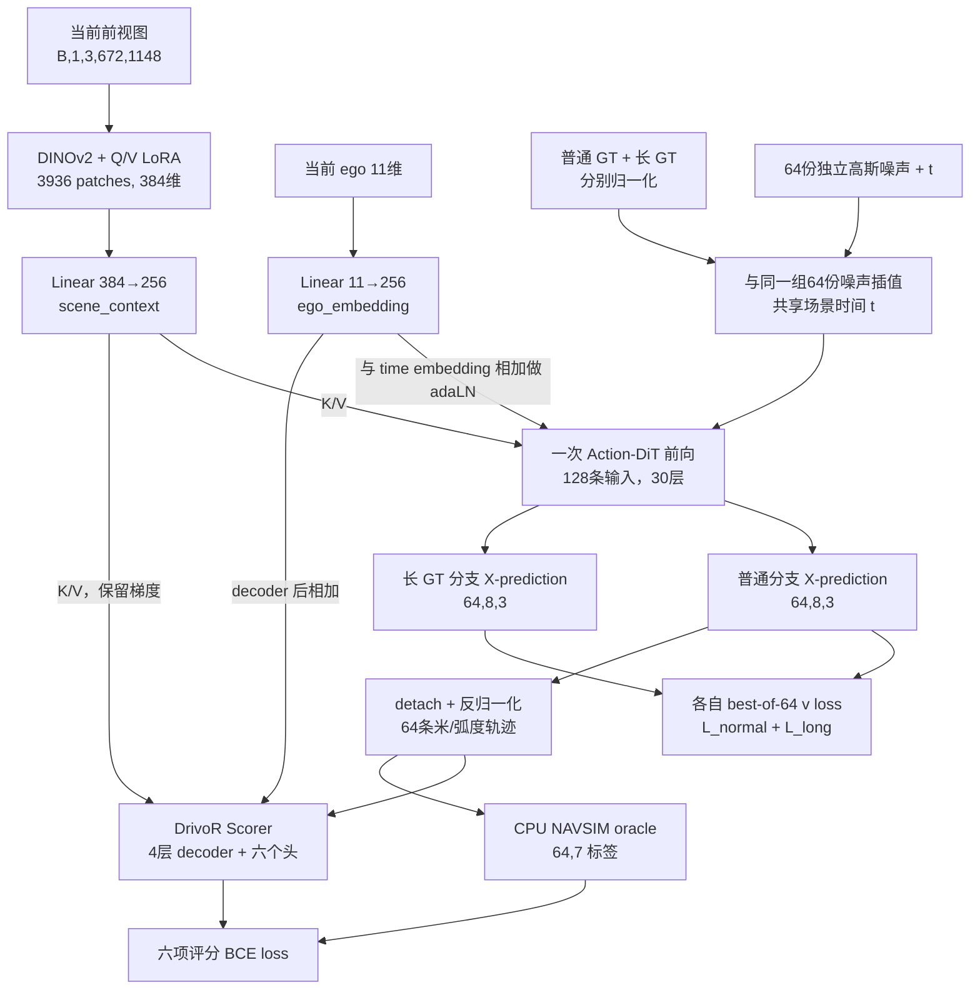

# DrivoR + Action-DiT：当前网络、训练与推理说明

更新日期：2026-10-14。本文依据 `/cpfs29jb/data/zhaozc/project/drive_future/DrivoR` 当前源码、`drivoR_action_dit.yaml` 及训练启动脚本整理。

当前模型使用 **一张当前前视图 → DINOv2 原生 patch 特征 → Action-DiT 轨迹预测 → DrivoR Scorer 选轨迹**。训练将普通/长 GT 两组输入合批，只执行一次带梯度的 DiT 前向；普通分支的 64 条 X-prediction 直接用于评分。验证和推理仍从纯噪声执行 10 步 Euler。

另有独立的 [DrivoR 多视图 Scene-query 变体](DRIVOR_ACTION_DIT_MULTIVIEW.md)：四个当前视角、每视角 16 个查询，向 DiT 和 Scorer 提供 `[B,64,256]` 特征。它使用新配置 `drivoR_action_dit_multiview` 和独立启动脚本；本文下面的默认配置仍指原单前视原生 patch 版本。

2026-10-15 新增可选的[多 GT 监督配置](DRIVOR_MULTI_GT.md)，同时覆盖单前视和多视图版。该配置用实际有效的 1–4 条 GT 替代下面的普通/长 GT 两项；64 个输入仍由原始 human GT 加噪构造，一次 X-prediction 后，每条有效 GT 从全部 64 个输出选最近者计算 v loss，Scorer 仍评分同一组 64 条。本文以下的 normal/long 合批说明适用于原配置。

多 GT 还可选择[匈牙利一对一匹配配置](DRIVOR_MULTI_GT_HUNGARIAN.md)：有效 GT 匹配到互不重复的 proposal，再按 GT 数平均 v loss。加噪输入、单次训练前向和推理步骤保持原有设置。

另有 [human / 非 human 加权多 GT 配置](DRIVOR_ACTION_DIT_MULTI_GT_WEIGHTED.md)，以 `human v loss + 0.5 * mean(非 human v loss)` 汇总同一组 64 条预测的监督，权重可配置，匹配采用独立最近邻。原有等权入口保持原行为。

视觉骨干也可选新增的 [DINOv3 ViT-S / ViT-L](DRIVOR_ACTION_DIT_DINOV3.md)：原参数冻结、Q/V LoRA、256 维投影、Scene queries 可选。本文下面仍描述 DINOv2 默认入口；DINOv3 使用独立配置和启动脚本。

2026-10-16 新增 [V-JEPA 2 ViT-L](DRIVOR_ACTION_DIT_VJEPA2.md)：加载官方预训练视觉编码器，冻结原参数，添加 Q/V LoRA；当前图像复制两次适配原生视频 patch embedding，支持原生 patches 和可选 Scene queries，沿用等权多 GT 训练。

同日新增 [V-JEPA 2.1 ViT-L](DRIVOR_ACTION_DIT_VJEPA2_1.md)：使用 2.1 官方 EMA 编码器的原生单图分支和 RoPE 坐标缩放，默认单前视 3024 patches，支持相同的 LoRA、可选 queries 和等权多 GT 配方。

本文描述的是当前代码。已经运行的旧 Python/DLC 任务不会自动加载修改，`exp/.../multinode` 中旧任务的配置、耗时不能直接代表本文实现。

## 1. 关键配置与整体流程

本文使用以下维度：`B` 是单卡 microbatch，默认 1；`M=64` 是候选数；`N=8` 是每条轨迹的点数；`P=3936` 是视觉 patch 数；`D=256` 是下游特征维度。

| 部分 | 当前配置 |
|---|---|
| 图像 | 当前帧 `CAM_F0` 一张，`[B,1,3,672,1148]` |
| Ego | 当前 11 维状态，经 `Linear(11,256)` 编码 |
| 视觉骨干 | DINOv2 ViT-S/14 reg4，384 维，Q/V LoRA rank 32 |
| 视觉 K/V | 原生 3936 个 patches，逐 token 投影为 256 维；生成器和 Scorer 共用 |
| Action-DiT | 30 层，hidden 256，FFN 1024，24 heads × head_dim 128 |
| DiT 输入/输出 | 每条轨迹 8 个 action tokens；输入加噪轨迹，输出归一化干净轨迹 `X-prediction` |
| 训练候选构造 | 64 份噪声分别与普通/长 GT 插值，合为 `[B,128,8,3]`，一次 DiT 前向 |
| 训练评分候选 | 普通 GT 分支的全部 64 条预测，反归一化、截断轨迹梯度后评分 |
| 轨迹 loss | 普通 GT、长 GT 分别 best-of-64 v loss，然后相加 |
| Scorer | 轨迹 MLP → 4 层 Transformer decoder → 加 ego → 六个评分 MLP |
| Scorer 标签 | 在线 CPU NAVSIM oracle，`[B,64,7]` |
| 验证/推理 | 64 份纯噪声，10 步 X→V Euler，Scorer 选择一条 `[B,8,3]` |
| 分布式默认值 | 8 节点 × 8 GPU × batch 1 × 累积 1 = global batch 64 |
| 精度与优化器 | BF16 mixed、CUDA fused AdamW、峰值 LR `2e-4` |

训练的数据流如下；`detach` 只切断轨迹坐标到评分分支的梯度，视觉和 ego 的评分梯度仍保留：



这里没有 text encoder、text embedding、VAE、video DiT、MoT 或 Future Register 分支。原版 `agent=drivoR` 的轨迹生成器没有实例化在这个变体中。

## 2. 数据输入、坐标系与 GT

### 2.1 图像与状态输入

| 数据 | batch 后形状 | 本模型的实际使用方式 |
|---|---|---|
| `features["image"]` | `[B,1,3,672,1148]` | 输入 DINO；实现也兼容 `camera_feature` 键 |
| `features["ego_status"]` | `[B,4,11]` | 只使用最后一帧 `[:, -1]` |
| `cam_K` / `world_2_cam` | `[B,1,3,3]` / `[B,1,4,4]` | DrivoR builder 会生成，但当前 Action-DiT 前向没有读取它们 |
| `targets["trajectory"]` | `[B,8,3]` | 普通轨迹监督 |
| `targets["trajectory_long"]` | `[B,8,3]` | 长轨迹监督 |
| `targets["token"]` | B 个场景标识 | 查找 metric cache，不作为网络 token |

相机配置为 `cam_f0=[3]`，其他七个相机和 `lidar_pc` 均为空。历史窗口有四帧，索引 3 是当前帧；只读取该帧前视图，不读取历史图像或未来图像。

图像通过 `PIL.resize((1148,672))` 调整大小，再转 float32、除以 255，并按 RGB 做 ImageNet 归一化：

```text
mean = [0.485, 0.456, 0.406]
std  = [0.229, 0.224, 0.225]
image = (image / 255 - mean) / std
```

进入视觉骨干前使用 GridMask，训练时启用，默认 `prob=0.7, ratio=0.5, mode=1, offset=False`；验证/推理不施加遮挡。图像读取采用本地文件、已有图像缓存、OSS 回退的顺序。Dataset 复用已经加载的 Scene 图像，避免再次构造 AgentInput 时重复解码。

### 2.2 Ego 的内容

11 维顺序固定为：

```text
[pose_x, pose_y, pose_heading,
 velocity_x, velocity_y,
 acceleration_x, acceleration_y,
 command_0, command_1, command_2, command_3]
```

当前帧以自身后轴为坐标原点，当前 `pose3=[0,0,0]`。因此当前有效状态信息主要来自速度、加速度和四维 route command，以及投影层的 bias。

模型的 ego 路径只有：

```text
ego_status[:, -1] [B,11]
    → Linear(11,256)
    → ego_embedding [B,256]
```

这里没有额外激活或 LayerNorm，也没有把 ego 当成额外 K/V token 拼进视觉序列。这个向量同时用于 DiT 的 adaLN 条件和 Scorer decoder 后的加法。

### 2.3 普通与长 GT 的来源

普通 GT 为当前自车后轴坐标系下的 `(x,y,heading)`，XY 单位米、heading 单位弧度；8 点对应未来 `0.5,1.0,...,4.0` 秒。它是相对当前坐标原点的绝对位置序列，不是相邻点位移。

长 GT 复用 `DrivoRTargetBuilder`。默认 `long_trajectory_additional_poses=2`，读取未来 10 点（到 5 秒），再对 x、y、heading 分别用 CubicSpline 重采样为 8 点。令 `N=8, a=2, i=0...7`：

```text
alpha = 2a / (N(N+1)) = 1/18
source_index = 0,1,...,9
query_index[i] = i + sum(j=0...i)((j+1)*alpha)
physical_time[i] = 0.5 * (query_index[i] + 1)
```

得到的物理采样时间约为：

```text
0.5278, 1.0833, 1.6667, 2.2778, 2.9167, 3.5833, 4.2778, 5.0000 秒
```

长 GT 构建失败时，现有 builder 用普通 GT 替代；此时两项轨迹监督仍会相加。长 GT 不会改变输出接口：生成轨迹和 NAVSIM 评分仍按 **8 点、0.5 秒间隔、4 秒 horizon** 解释。

## 3. DINOv2 原生 patch 特征

实现为 [`NativePatchImageEncoder`](navsim/agents/drivoR_action_dit/image_encoder.py)，骨干为 `vit_small_patch14_reg4_dinov2.lvd142m`，使用本地 DINOv2 权重。

| 模块 | 结构与输出 |
|---|---|
| Patch embedding | 14×14 patch，特征宽度 384 |
| ViT-S 主干 | 12 个 Transformer blocks，6 个 heads，原生位置编码、CLS、registers |
| Q/V LoRA | 各 block 的 Q、V 投影各增加 `384→32→384`，无 bias；K 不加 LoRA |
| 参数冻结 | 原 DINO 参数全部冻结；新增 Q/V LoRA 可训练 |
| 输出 neck | `Linear(384,256)`，可训练 |

token 数量为：

```text
patch 网格：672/14 × 1148/14 = 48 × 82 = 3936
DINO 内部：CLS 1 + registers 4 + patches 3936 = 3941 tokens
最后只取 patch 输出：[B,3936,384]
逐 patch 投影：Linear(384,256)
scene_context：[B,3936,256]
```

CLS 和四个 register tokens 保留在 DINO 内部 attention 中，但不进入下游 K/V。没有插入原 DrivoR 的 16 个 Scene queries，也没有对 patches 做 pooling 或 query 压缩。

LoRA 使用原 DrivoR 的 Q/V 注入模块；A 矩阵初始化、B 矩阵零初始化。Native encoder 直接调用原生 ViT 的 `forward_features`，没有替换成 DrivoR 的 Scene-query 注入方法。

**Action-DiT 和 Scorer 的视觉 K/V 都来自同一份 `[B,3936,256]` 特征。** 只编码一张前视图，所以不是四视角对应的 15,744 个 patches。

共享的是输入特征；Action-DiT 各层和 Scorer 各层仍有各自的 K/V 投影参数，并不共享投影矩阵。

## 4. Action-DiT：输入、条件与 30 层结构

### 4.1 输入投影与条件

令 `M'` 为本次 DiT 调用的轨迹数：训练双 GT 合批时为 128，验证/推理时为 64。每条轨迹仍为 8 个点。

```text
noisy_action [B,M',8,3]
    → action_encoder: Linear(3,256)
    → action tokens H [B,M',8,256]

timestep [B,M']
    → 256维 sinusoidal embedding
    → Linear(256,256) → SiLU → Linear(256,256)
    → time_embedding [B,M',256]

condition = time_embedding + ego_embedding[:,None,:]
t_mod = Linear(256,1536)(SiLU(condition))
    → reshape [B,M',6,256]
```

time embedding 的输入是 flow 时间 `t=1000σ`；轨迹点 0…7 的顺序则由 self-attention 的 RoPE 表达，两者不是同一种时间。

当前没有额外的 learned mode query。候选之间共享场景特征和同一场景的 time/ego 条件，多样性来自不同的噪声矩阵。time/ego 通过 adaLN 调制进入各层，不把原始 ego 坐标加到轨迹坐标上。

### 4.2 每个 ActionBlock

| 子模块 | 实际结构 |
|---|---|
| Self-attention 前处理 | affine-free LayerNorm，eps=`1e-6`，再做 adaLN shift/scale |
| Self-attention | Q/K/V 各 `Linear(256,3072)`；24 heads × 128；Q/K RMSNorm；1D RoPE；输出 `Linear(3072,256)` |
| Cross-attention 前处理 | 带 affine 的 LayerNorm，eps=`1e-6` |
| Cross-attention | Action 作 Q，DINO patches 作 K/V；Q/K/V 各 `256→3072`；Q/K RMSNorm；输出 `3072→256` |
| FFN 前处理 | affine-free LayerNorm，再做 adaLN shift/scale |
| FFN | `Linear(256,1024) → GELU(approximate=tanh) → Linear(1024,256)` |
| 调制参数 | 每层可训练 `modulation [1,6,256]` 与共享 `t_mod` 相加 |

六个调制量依次为 `shift_sa, scale_sa, gate_sa, shift_ff, scale_ff, gate_ff`，每个广播到对应候选的 8 个点：

```text
[shift_sa, scale_sa, gate_sa, shift_ff, scale_ff, gate_ff]
    = split(t_mod + block.modulation)

H = H + gate_sa * SelfAttention(LN_no_affine(H)*(1+scale_sa) + shift_sa)
H = H + CrossAttention(LN_affine(H), scene_context)
H = H + gate_ff * FFN(LN_no_affine(H)*(1+scale_ff) + shift_ff)
```

该 block 重复 30 次。cross-attention 没有额外的 adaLN gate，也没有 RoPE。Q/K 的 RMSNorm 按参考实现作用于拆 heads **之前的完整 3072 维**，不是逐 head 的 128 维。

self-attention 只在同一条轨迹的 8 个点之间计算，不跨候选，也不跨普通/长 GT 分支；不是 causal attention。每条轨迹的 RoPE 位置都从 0 开始。

### 4.3 Attention 的实际张量大小

| 路径 | Q | K/V |
|---|---|---|
| DiT self-attention | `[B*M',24,8,128]` | `[B*M',24,8,128]` |
| 训练 cross-attention，M'=128 | `[B,24,1024,128]` | `[B,24,3936,128]` |
| 推理 cross-attention，M'=64 | `[B,24,512,128]` | `[B,24,3936,128]` |

cross-attention 合并的是候选与点构成的 **query 维**，K/V 在每层、每次 DiT 调用中只对场景投影一次，不复制成 64 或 128 份。每个 query 仍独立读取视觉 K/V，合并 query 不会使不同候选互相 self-attend。

`hidden_dim=256` 不等于 attention 内部宽度为 256。内宽 3072 是指定预训练权重的结构，也是该模型计算量和参数量较大的原因。

### 4.4 X-prediction 输出头

```text
H_final [B,M',8,256]
    → head: Linear(256,3)
    → X_pred [B,M',8,3]
```

直接输出归一化的干净轨迹。这里没有 tanh、额外输出 LayerNorm、额外调制头，也没有把网络输出当作 v。参考仓库虽然定义了其他 `ActionHead`，指定的 ActionDiT 实际使用普通 Linear，本实现保持这一点。

## 5. 64 份噪声、时间 t 与 global rank

### 5.1 同一场景内的采样

每个训练 batch 重新执行：

```python
u = torch.rand(B, 1, device=device)          # 每场景一个时间随机数
sigma = 5 * u / (1 + 4 * u)
t = (1000 * sigma).expand(B, 64)
epsilon = torch.randn(B, 64, 8, 3, device=device)
```

每个候选的噪声是一整个 `[8,3]` 高斯矩阵，64 份噪声值不同。它们共享同一场景的 σ/t，因此噪声强度相同，便于进行同一噪声水平下的 best-of-64 比较。

| 比较范围 | ε | t / σ |
|---|---|---|
| 同一场景内 64 个候选 | 独立采样 | 共享一个 |
| 普通/长 GT 的同编号候选 | 逐元素共用 | 共用 |
| 同一卡的下一个 batch | 重新采样 | 重新采样 |
| 同一 batch 中不同场景 | 各自采样 | 每场景各采一个 |
| 不同 global rank | 来自不同模型随机流 | 来自不同模型随机流 |

普通/长 GT 合计 128 个训练输入，只使用 **64 份独立噪声矩阵**，不是再独立采样另外 64 份。

### 5.2 分布式随机流

训练入口先用公共 `seed` 初始化模型、建立数据加载器。DDP 就绪后的 `AgentLightningModule.on_train_start()` 再执行 FastWAM 的规则：

```text
process_seed = seed + global_rank
```

它设置 Python、NumPy、Torch CPU 和 CUDA 随机流；不再次调用 `pl.seed_everything`，不改写 `PL_GLOBAL_SEED`。默认基础 seed=2 时：

| global rank | 模型随机 seed |
|---:|---:|
| 0 | 2 |
| 1 | 3 |
| 8 | 10 |
| 63 | 65 |

使用的是全局 rank，不是各节点重复的 local rank。训练 DataLoader 的独立 Generator 使用公共 seed=2，验证 Loader 使用公共 seed+1=3；DistributedSampler 仍遵循公共 seed。

模型 seed 只在训练启动时设置，不在每个 batch 或 epoch 重置。`runtime.rank_seeded_training=true` 默认启用，设为 false 可关闭。不同随机流不等于强制所有随机数值绝不偶然重复。

当前 checkpoint 没有新增每个 rank 的 RNG 状态保存；重新启动/断点恢复会从该 rank 的 seed 初始化，不承诺恢复之前随机流的精确位置。

## 6. 轨迹归一化、加噪与 v loss

### 6.1 归一化与反变换

普通和长 GT 使用同一套 FastWAM NAVSIM absolute 归一化。对当前自车坐标系下的 `(x,y,h)`：

```text
x_norm = 2*(x + 1.57)/66.74 - 1
y_norm = 2*(y + 19.68)/42.00 - 1
h_norm = 2*(h + 1.67)/3.53 - 1

x = (x_norm + 1)*66.74/2 - 1.57
y = (y_norm + 1)*42.00/2 - 19.68
h = (h_norm + 1)*3.53/2 - 1.67
```

不 clip 到 `[-1,1]`，不累加相邻点位移。模型反归一化也不额外限制 heading 范围。送入 Scorer、NAVSIM oracle 和最终输出的坐标都是米/弧度。

### 6.2 两组合法的 flow 输入

先把两个归一化 GT 各自扩展为 `[B,64,8,3]`：

```text
X_sigma_normal[b,m] = (1-sigma[b])*GT_normal_norm[b] + sigma[b]*epsilon[b,m]
X_sigma_long[b,m]   = (1-sigma[b])*GT_long_norm[b]   + sigma[b]*epsilon[b,m]

packed_input = cat([X_sigma_normal, X_sigma_long], candidate_dim)
             # [B,128,8,3]
```

σ=0 时输入为干净 GT，σ=1 时为纯噪声。当前训练采样一般处于两者之间；不是每批都把纯噪声直接拿来计算轨迹监督。

### 6.3 X-prediction 转为 v 误差

不截断分母时：

```text
v_target = epsilon - GT_norm
v_pred   = (X_sigma - X_pred) / sigma
v_pred - v_target = (GT_norm - X_pred) / sigma
```

小 σ 会放大误差，所以训练使用 `sigma_safe=max(sigma,0.1)`，预测与目标采用同一个分母：

```text
v_pred_safe   = (X_sigma - X_pred) / sigma_safe
v_target_safe = (X_sigma - GT_norm) / sigma_safe
v_error       = (GT_norm - X_pred) / sigma_safe
```

实际 loss 用最后一行的等价残差，避免两个较大 velocity 相减的数值抵消；这些运算使用 FP32。`X_pred=GT_norm` 时，即使 σ<0.1，误差仍为零。

该下界只控制 loss 换算，不修改随机采样的 t，不把加噪时的 σ 强制抬到 0.1。平方误差中的分母放大因子最多为 100；最终还乘以时间权重。

### 6.4 时间权重与两项 best-of-64

保留参考时间权重：

```text
y(sigma) = exp(-2*(sigma-0.5)^2)
w(sigma) = (y(sigma)-y_min) / (mean_on_reference_grid(y-y_min) + 1e-10)
```

参考网格使用 1000 个 `linspace(1,0,1001)[:-1]` 位置，再做 shift=5。每条候选对 8 点×3 维求均方：

```text
E_normal[b,m] = mean_(8*3)(v_error_normal[b,m]^2)
E_long[b,m]   = mean_(8*3)(v_error_long[b,m]^2)

L_normal = mean_b(w(sigma[b]) * min_m E_normal[b,m])
L_long   = mean_b(w(sigma[b]) * min_m E_long[b,m])
L_flow   = L_normal + L_long
```

两个分支独立选择最佳候选，最优 index 可以不同；没有 Hungarian 一对一匹配，也不对 64 条候选的轨迹 loss 全部求平均。该变体没有额外的原版轨迹 L1、候选排斥/diversity loss 或逐层轨迹监督。

关闭长 GT 时只构造 64 条输入，保留普通分支 loss；当前默认开启长 GT。

## 7. 当前训练：一次 DiT 前向完成轨迹与评分

正式调用链为：

```text
Lightning.training_step
  → agent.forward_train(features, targets)
      → model(features, targets=targets)
      → encode_scene：一次 DINO、一次 ego Linear
      → flow_training_outputs：一次 DiT，处理128条输入
          → normal_x [B,64,8,3]
          → L_normal + L_long
      → denormalize(normal_x.detach().float())
      → score_proposals：一次神经网络 Scorer
  → agent.compute_loss(features, targets, pred)
      → 复用 pred["_flow_loss"]
      → 对同一组64条候选计算在线 Oracle 标签
      → 六项评分 BCE
      → 总 loss
  → backward / optimizer step
```

普通分支 **全部 64 条 X-prediction** 直接进入评分，不按 GT loss 先选一条，也不把普通 GT 本身当成候选。长 GT 分支的 64 条预测用于轨迹监督，不额外加入评分集合。

训练不执行 Euler 采样，`compute_loss` 不再次调用 DiT。`flow_training_loss()` 是保留的独立数值辅助接口，正式训练通过 `flow_training_outputs()` 的结果复用完成。

训练评分候选是加噪普通 GT 的去噪预测；验证/推理候选从纯噪声积分得到，两者的构造方式不同。验证/推理的模型前向不接收 GT。

## 8. DrivoR Scorer、Oracle 标签与评分 loss

### 8.1 神经网络 Scorer

Scorer 的输入是已反归一化且截断坐标梯度的 `[B,64,8,3]`：

```text
候选坐标 → flatten [B,64,24]
  → Linear(24,1024) → ReLU → Linear(1024,256)
  → 4层 TransformerDecoderScorer
  → 加 ego_embedding[:,None,:]
  → 六个独立评分 MLP
```

每个 decoder block 为：

1. LayerNorm → self-attention → 残差，64 个候选之间可以交互。
2. Q、视觉 K/V 分别 LayerNorm → cross-attention → 残差。
3. LayerNorm → `Linear(256,1024) → GELU → Linear(1024,256)` → 残差。

当前 `d_model=256`、**num_heads=1**、projection/FFN dropout=0.1、DropPath=0.2；LayerScale 配置为 0，因此使用 Identity。内部 `MultiheadAttention` 的 attention dropout 为 0，`need_weights=false`。

Scorer Q 为 `[B,64,256]`，K/V 为当前前视 `[B,3936,256]`。这里一条轨迹对应一个 Scorer token；**DiT 中一条轨迹仍对应 8 个 action tokens**。继承配置里的 `one_token_per_traj=true` 不会把 DiT 的 8 个点压成一个 token。

Scorer 不额外接收 flow 时间 t 或原始噪声；它读取干净轨迹预测、当前视觉特征和 ego embedding。

六个独立 MLP 都是 `Linear(256,1024) → ReLU → Linear(1024,1)`，各输出 `[B,64]` logits：NC、DAC、TTC、EP、DDC、Comfort。默认不构建第二套评分头、agent/area/BEV 辅助头。

### 8.2 评分 GT 来自哪里

标签由当前预测候选在真实场景中的 NAVSIM/PDM oracle 生成，**不是候选到普通/长 GT 的距离，也不是候选编号的分类标签**。

```text
反归一化候选 [B,64,8,3]
  → detach + FP32 + CPU NumPy
  → 按场景 token 读取 metric cache
  → 相对轨迹转全局并插值为 [64,41,11]
  → 0.1秒步长、4秒的 PDM 车辆模拟
  → 基于地图、环境观测、参考轨迹计算各项指标
  → raw7 [B,64,7]，再转回模型设备用于监督
```

| raw7 下标 | 指标 | 含义 |
|---:|---|---|
| 0 | NC | 无责任碰撞 |
| 1 | DAC | 可行驶区域合规 |
| 2 | EP | 相对 PDM 参考的行驶进度 |
| 3 | TTC | TTC 安全性；异常 sentinel=2 在 BCE 中屏蔽 |
| 4 | Comfort | 舒适性 |
| 5 | DDC | 行驶方向合规 |
| 6 | Final PDMS | 综合评分，用于评价和选轨迹质量统计 |

EP 对每条候选单独归一化：先用 NC×DAC 加权候选原始进度，再与同一场景的固定 PDM 参考进度取逐元素最大值。最大进度大于 5 米时用二者比值；低进度且候选未被乘性指标判零时 EP=1，否则 EP=0。它不是拿当前 64 条或某个分块中的最佳候选作分母，因此可以按候选分块计算。

正常评分下，当前权重的综合指标为：

```text
PDMS = NC * DAC * (5*EP + 5*TTC + 2*Comfort) / 12
```

DDC 的聚合权重当前为 0，但其预测头仍接受监督。`raw7` 始终是每候选一组标签，不是 `[64,2]` 的候选×GT 配对矩阵。

metric cache 保存场景观测、地图和参考轨迹，不保存当前网络这一批的候选分数。标准 cache 缺少 `pdm_progress` 时，按参考轨迹补算；每进程缓存解压字节和参考值，评分时仍产生新候选标签。

### 8.3 六项 BCE

各头使用 `binary_cross_entropy_with_logits`。默认六项 loss 权重都是 1：

```text
L_score = L_NC + L_DAC + L_EP + L_TTC + L_DDC + L_Comfort
```

处理细节：

- NC 和 DDC 标签中的 0.5 转为 0；在 clone 后转换，避免修改原始 raw7。
- DAC、EP、Comfort 直接使用对应标签；EP 等连续标签保留 FP32，不先量化成 BF16。
- TTC 使用 `mask = (target_TTC != 2)`；`L_TTC = sum(mask * BCE) / max(sum(mask),1)`。全部无效时该项为 0。
- 其余各项对当前 batch 的全部候选取均值。
- 第七项 Final PDMS 没有单独的回归头和 MSE loss。代码中的 `final_score_loss` 指六项 BCE 的加权和。

### 8.4 如何选出最终轨迹

令 `p_i=sigmoid(logit_i)`。当前选轨迹使用：

```text
utility = log(p_NC) + log(p_DAC)
        + log(5*p_TTC + 5*p_EP + 2*p_Comfort)
selected_index = argmax(utility, candidate_dim)
```

实现对乘性项使用 FP32 `logsigmoid`，对加权和先 `clamp_min(1e-12)` 再取 log。DDC 权重为 0，不参与当前 utility；省略除以 12 的常数不改变排序。

这里的 **5/5/2 是选轨迹的指标权重，不是三个 BCE 的训练权重**。`pdm_score` 输出实际是 log utility，不应直接当作 `[0,1]` 的真实 PDMS。

## 9. 总 loss 与梯度边界

默认总 loss：

```text
L_total = 1.0 * (L_normal_best64_v + L_long_best64_v)
        + 1.0 * L_score
```

| 参数/模块 | 轨迹 v loss 更新 | 评分 loss 更新 |
|---|---|---|
| DINO 原始预训练参数 | 否，冻结 | 否，冻结 |
| DINO Q/V LoRA | 是 | 是 |
| 视觉 `Linear(384,256)` | 是 | 是 |
| Ego `Linear(11,256)` | 是 | 是 |
| Action encoder、time embedding/projection、30 层 DiT、X head | 是 | 否 |
| Scorer 轨迹 MLP、4 层 decoder、六个 MLP 头 | 否 | 是 |
| CPU oracle、轨迹 GT、噪声、t | 无可训练参数/不求梯度 | 无可训练参数/不求梯度 |

评分分支截断的是轨迹坐标，不是共享视觉 K/V 或 ego。这样评分 loss 可以训练感知与评分器，但不会通过候选坐标回传到 Action-DiT。

## 10. 验证/推理：10 步 X→V Euler

调用 `agent.forward(features)`，先编码图像和 ego 一次，然后从新的 64 份纯高斯噪声开始：

```text
epsilon [B,64,8,3] ~ N(0,I)
x = epsilon
u_grid = linspace(1,0,11)
sigma_grid = 5*u_grid / (1+4*u_grid)

for i = 0...9:
    X_pred = ActionDiT(x, t=1000*sigma_grid[i], scene_context, ego_embedding)
    v_pred = (x - X_pred) / sigma_grid[i]
    x = x + (sigma_grid[i+1]-sigma_grid[i]) * v_pred

proposals = denormalize(x)
selected_trajectory = Scorer选择的候选
```

生成在 `no_grad` 下执行，不在步间重新加噪。每一步 X-prediction 都预测干净轨迹，但验证/推理按已确定的多步积分方案更新当前状态。

只在正 σ 调用 DiT，σ=0 是积分终点。最后一步 `delta=-sigma`，更新结果正好等于 X-prediction，代码直接返回它。推理使用真实 σ，不使用训练 loss 的 0.1 下界；默认 10 步/shift=5 的最后正 σ 约为 0.3571。

K/V 在每个 DiT 调用内共享给所有候选，但当前没有跨 10 个 Euler 步缓存各层 K/V 投影，因此每个步仍会重新投影；DINO 图像编码本身只执行一次。

| 阶段：每 batch | DINO 编码 | 显式 DiT 前向 | 神经网络 Scorer | CPU Oracle |
|---|---:|---:|---:|---|
| 当前训练，双 GT | 1 | **1**，128 条合批 | 1，64 条 | 一次候选评分请求，64 条 |
| 当前验证 | 1 | **10**，每次 64 条 | 1，64 条 | 当前代码分别算选中 1 条和全部 64 条 |
| 纯模型推理 | 1 | **10**，每次 64 条 | 1，64 条 | 不需要 |

表中不计反向传播的 gradient-checkpointing 重算。DINO 和 DiT 默认开启 checkpointing；DiT 使用 `use_reentrant=false`，反向可能重算 block，以节省显存。

## 11. 输出接口

| 输出键 | 形状/含义 |
|---|---|
| `proposals` | `[B,64,8,3]`，米/弧度的全部候选 |
| `trajectory` | `[B,8,3]`，utility 最大的候选 |
| `proposal_list` | 长度 1 的列表，元素是上述 candidates；没有逐层轨迹列表 |
| `pred_logit` | 六个键，各 `[B,64]` 的原始 logits |
| `pdm_score` | `[B,64]`，排序用的 log utility |
| `_scene_context` / `_ego_embedding` | 本 batch 的共享特征，不跨 batch 缓存 |
| `_flow_loss` | 仅训练前向返回的可求梯度标量，供 `compute_loss` 复用 |
| `_flow_diagnostics` | 仅训练：`flow_normal_loss`、`flow_long_loss`、`flow_time_mean` |
| 其他辅助头输出 | 默认 `None` |

`compute_loss` 返回 `loss`、`trajectory_loss`、`final_score_loss`、六个子 loss、所选候选的真实 `score`、64 条中的真实 `best_score` 和 flow 诊断量。`best_score` 只用于统计，不用 oracle-best 候选替代模型实际选中的轨迹。

## 12. 预训练权重与参数初始化

### 12.1 两个预训练来源

| 部分 | 当前路径 |
|---|---|
| DINOv2 ViT-S/14 reg4 | `DrivoR/weights/vit_small_patch14_reg4_dinov2.lvd142m/model.safetensors` |
| Action-DiT 256 | `/cpfs29jb/data/zhaozc/project/FastWam_re/checkpoints/ActionDiT_linear_interp_Wan22_alphascale_256hdim_1024ffn_3outdim.pt` |

参考配置是 FastWAM 的 `configs/task/navsim_uncond_front_384x672_action256_1e-4.yaml` 与 `configs/model/fastwam_navsim_action256.yaml`。这里只参考 Action-DiT、时间规则和轨迹归一化，图像分辨率使用本项目 DrivoR 的 672×1148。

### 12.2 Action-DiT 的实际加载范围

指定文件是预处理后的 checkpoint，包含 `policy`、`meta` 和 `backbone_state_dict`。其中的 policy 已执行 alpha scaling 和一维线性插值，并声明跳过 `action_encoder.` 与 `head.`；本加载器不再次做这些转换。

| 项目 | 数量/处理 |
|---|---|
| 准备文件 | 820 个 tensors、207,150,080 个元素，含未使用的 text embedding |
| 加载的非 text 主干 | 816 个 tensors、206,035,456 个参数 |
| 当前 ActionDiT 参数总量 | 206,037,251，约 2.060 亿 |
| 随机初始化 I/O | `action_encoder.weight/bias`、`head.weight/bias`，共 1,795 个参数 |
| 移除的文本参数 | `text_embedding` 的四个 tensors，不实例化文本分支 |

因此虽然文件名含 `3outdim`，这个准备文件本身没有 I/O 的四个 tensors。所有 30 层 attention、FFN、调制参数、time embedding 和 time projection 均从该文件加载。检查必要 metadata、键名和形状，不增加 hash/SHA 校验。

新增视觉 neck、ego Linear、Scorer 轨迹 MLP、四层 decoder 和六个评分头随机初始化；**不加载 DrivoR Release 的 Scorer 权重**。DINO LoRA 的初始增量为零。

完整模型在已有真实 smoke 中显示约 **2.36 亿参数、2.12 亿可训练参数**。主要参数来自 attention 内宽 3072 的 Action-DiT，不能只按 hidden=256 判断模型大小。

完整训练续跑使用 `train_ckpt_path`/Trainer checkpoint，恢复本变体的模型、optimizer、scheduler 和训练位置；这与上述新模型的预训练初始化不同。Action-DiT 本变体和原版 DrivoR 的完整模型 checkpoint 不能互换。

`training_drivoR_action_dit_navtrain/multinode` 的 `version_3/epoch=24-step=33250.ckpt` 已有独立的[单节点 navtest 评测入口和 DLC 命令](scripts/evaluation/README.md)，使用单前视配置严格加载完整权重，并以 10 步 Euler 生成候选。

## 13. 训练启动、优化器与运行加速

### 13.1 启动入口

在 PAI-DLC 配置 8 节点、每节点 8 GPU，启动命令填写一次，由平台分发。新实验示例：

```bash
cd /cpfs29jb/data/zhaozc/project/drive_future
export DRIVOR_RUN_ID=action_dit_xpred_seed2_run1
bash DrivoR/scripts/training/run_drivor_action_dit_training.sh \
  auto_resume=false \
  runtime.console_log_interval=25
```

入口复用 `run_drivor_training.sh` 的环境、数据和分布式设置，执行 `navsim/planning/script/run_training.py`。默认 Conda 环境是 `/cpfs29jb/data/zhaozc/miniconda3/envs/drive_future`；`PYTHONPATH` 优先使用本目录的 `DrivoR/` 和 `nuplan-devkit/`。

DLC 外层 `WORLD_SIZE/RANK` 是节点数/节点编号，内部 torchrun 子进程才是全局 GPU ranks。脚本自动读取节点地址和端口，无需 hostfile 或逐节点手动启动，也不要再额外嵌套 torchrun。

恢复当前 run 可使用 `auto_resume=true runtime.require_resume=true`。自动发现只搜索该 run 的输出目录，优先最新 `last.ckpt`；显式 `train_ckpt_path` 优先。参数结构兼容的旧 Action-DiT checkpoint 可以继续训练，但启动后会采用当前的训练候选构造和随机流规则。

只查看配置、不启动 GPU 或跨节点等待：

```bash
bash DrivoR/scripts/training/run_drivor_action_dit_training.sh \
  --cfg job --package agent --resolve
```

### 13.2 Batch、学习率和调度

```text
effective_batch = batch_size * num_gpus * accumulate_grad_batches
                = 1 * 64 * 1 = 64
peak_lr = 2e-4 * sqrt(effective_batch / 64)
```

默认 25 epochs、AdamW，CUDA 使用 fused 更新；其余未显式设置的 AdamW 参数沿用 PyTorch 默认值。新建 scheduler 使用 10% 线性 warmup（start_factor=`1e-6`），随后 cosine，按 optimizer step 更新。

默认每个 epoch 末尾验证一次，`num_sanity_val_steps=0`。当前读取原始数据，`cache_path=null`、`use_cache_without_dataset=false`，没有使用预计算的神经网络视觉特征缓存。

当前 Action agent 仍按配置数据量估计 scheduler 长度：

```text
total_steps = ceil(85000 / effective_batch) * 25 = 33225
warmup_steps = int(0.1 * total_steps) = 3322
cosine_steps = 29903
```

这不是 Trainer 的实际 step 总数。以当前 85109 个训练样本、64 ranks、batch 1 为例，DistributedSampler 每 rank 1330 条，25 epochs 实际为 33250 updates；文档不把两个数字混用。完整 checkpoint 恢复时，以其中保存的 optimizer/scheduler 状态为准。

### 13.3 数据与默认加速项

| 项目/环境变量 | 当前启动脚本默认值 |
|---|---|
| `OPENSCENE_DATA_ROOT` | `drive_future/data/navsim` |
| `NAVSIM_METRIC_CACHE_PATH` | `drive_future/data/metric_cache_navtrain` |
| `NAVSIM_EXP_ROOT` | `DrivoR/exp` |
| `DRIVOR_PRECISION` | `bf16-mixed` |
| `DRIVOR_NUM_WORKERS` | 每 GPU rank 4 个数据 workers |
| `DRIVOR_PREFETCH_FACTOR` | 2；pin memory、persistent workers 开启 |
| `DRIVOR_CPU_THREADS` | 1，限制 OMP/MKL/OpenBLAS/NumExpr 线程 |
| `NAVSIM_ORACLE_WORKERS` | 每 rank 2 个常驻 CPU 进程，各算 32 条候选 |
| `NAVSIM_ORACLE_FAST_PATH` | 1，批量构造轨迹状态数组 |
| `NAVSIM_ORACLE_CACHE_ENTRIES` | 每进程默认 8 份解压缓存和参考进度 |
| `DRIVOR_FUSED_ADAMW` | true |
| `DRIVOR_PERF_ENABLED` | false；可选开启每 rank 分段计时 |
| `runtime.rank_seeded_training` | true |

场景级 worker 配置仍是 `worker=sequential`；候选分块在其内部用持久 spawn 进程池完成，不启动 Ray，也没有把 PDM 指标算法改成 GPU。各进程持有独立可变 scorer 状态；遇到 TTC 整批异常 sentinel 时，会按原评分语义回退到整批串行计算。

其他加速包括：Scene 图像复用、固定 token 索引、训练全局指标改为 epoch 汇总。`train_step/*` 是 rank 0 本地 step 曲线；`train/*` 为跨 rank 的 epoch 均值。控制台默认每 25 个 batch 输出 loss、LR 和训练 ETA，ETA 不包含后续验证/保存耗时。

只有当前前视会被请求。缺失图像可通过 OSS 回退读取，凭据路径为 `/mnt/human/shixi/human/oss_config.json`，不把凭据内容写入代码或文档。图像下载缓存和 metric cache 是不同用途。

可设 `DRIVOR_PERF_ENABLED=true DRIVOR_PERF_SAMPLE_EVERY=10` 记录 `<run>/performance/rank_XXXXX.jsonl`，然后用 `environment/performance/summarize_rank_performance.py` 汇总。默认计时是主机调用间隔；Oracle 嵌在 loss 内，异步 GPU 时间和等待不能重复相加。

### 13.4 继承配置中容易混淆的字段

| 字段 | 在当前变体中的作用 |
|---|---|
| `action_dit.num_layers=30` | 轨迹生成器的实际层数 |
| `scorer_ref_num=4` | Scorer decoder 的实际层数 |
| `ref_num=4` | 原 DrivoR 生成器配置，不能据此推断本变体是 4 层 DiT |
| `action_dit.num_heads=24` | DiT attention heads |
| `refiner_num_heads=1` | 当前 Scorer decoder 的 attention heads |
| `num_scene_tokens=0` | 不向 DINO 插入额外 Scene queries |
| `one_token_per_traj=true` | 保留 Scorer 等原配置；DiT 仍每点一个 token |
| `lidar_backbone` 等继承字段 | `lidar_pc=[]` 时不构建、不读取 LiDAR 分支 |
| `num_inference_steps=10` | 控制验证/推理 Euler，不增加训练前向次数 |

## 14. 已有验证与源码索引

本次是文档核对与重写，没有重新进行大规模训练。以下为已有、已完成的验证；测试集合有重叠，不能把数量直接相加。

| 验证 | 已完成内容 | 证据 |
|---|---|---|
| 加速移植 | 90 项针对性检查；原版和 Action-DiT 分别完成真实双 A100 两步训练及验证 | [加速验证](../artifacts/drivor_speed_port_20261014/validation.json) |
| 单次 X-prediction 训练 | 66 项检查；实际 Lightning 单次 DiT 调用、64 条评分复用、梯度截断；真实双 A100、BF16、在线 Oracle 两步训练及验证 | [单次前向验证](../artifacts/action_dit_one_step_20261014/validation.json) |
| global-rank 随机流 | 64 项检查；轻量双 A100/NCCL 验证初始化/数据 seed 一致、模型 seed 不同、CUDA 噪声/t 不同、普通/长 GT 共享关系保持 | [随机流验证](../artifacts/drivor_rank_seed_20261014/validation.json) |

随机流 smoke 使用微型预测器、真实 flow 输入构造器和合成数据；不代表完整模型或 NAVSIM 指标。完整网络 smoke 含冷启动并开启反向异常检测，也不应当作正式吞吐或模型收敛结果。

旧单前视形状检查可见 [历史形状记录](../environment/drivor_action_dit_validation.json)。其中早期分支使用过训练用的多步采样及模拟 Oracle，不再作为当前训练速度、显存占用或真实 PDMS 的依据。

需要复查数值与接口时，可运行针对性检查：

```bash
PYTHONPATH=DrivoR:DrivoR/nuplan-devkit \
OMP_NUM_THREADS=1 MKL_NUM_THREADS=1 OPENBLAS_NUM_THREADS=1 \
  /cpfs29jb/data/zhaozc/miniconda3/envs/drive_future/bin/python -m pytest -q \
  DrivoR/tests/test_action_dit.py DrivoR/tests/test_rank_seed.py
```

| 代码 | 职责 |
|---|---|
| [Action 配置](navsim/planning/script/config/common/agent/drivoR_action_dit.yaml) | 前视、DiT、flow 超参数 |
| [model.py](navsim/agents/drivoR_action_dit/model.py) | 编码、单次训练预测复用、Scorer、Euler |
| [action_dit.py](navsim/agents/drivoR_action_dit/action_dit.py) | attention、adaLN、X head、预训练加载 |
| [image_encoder.py](navsim/agents/drivoR_action_dit/image_encoder.py) | 原生 DINO patches、LoRA、neck |
| [flow.py](navsim/agents/drivoR_action_dit/flow.py) | 归一化、t 采样、X/V 换算、best-of-64 |
| [agent.py](navsim/agents/drivoR_action_dit/agent.py) / [loss.py](navsim/agents/drivoR_action_dit/loss.py) | 训练接口、优化器、组合 loss |
| [drivor_features.py](navsim/agents/drivoR/drivor_features.py) | 图像/ego 特征、普通与长 GT |
| [transformer_decoder.py](navsim/agents/drivoR/transformer_decoder.py) / [scorer.py](navsim/agents/drivoR/score_module/scorer.py) | 四层 Scorer 和六个 MLP |
| [drivor_loss.py](navsim/agents/drivoR/layers/losses/drivor_loss.py) | 复用的六项评分 BCE |
| [compute_navsim_score.py](navsim/agents/drivoR/score_module/compute_navsim_score.py) / [train_pdm_scorer.py](navsim/agents/drivoR/score_module/train_pdm_scorer.py) | 在线标签、参考进度、候选并行 |
| [random_seed.py](navsim/planning/training/random_seed.py) / [agent_lightning_module.py](navsim/planning/training/agent_lightning_module.py) | rank 随机流、训练调用、日志 |
| [训练说明](scripts/training/README.md) | DLC 命令、路径、运行参数 |
