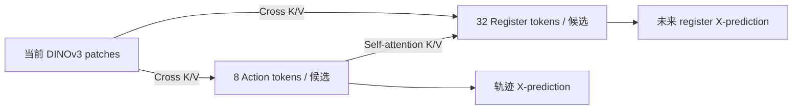

# Action-DiT：64 组轨迹/未来 registers、EMA DINOv3 和三种训练方式

以 `run_drivor_action_dit_dinov3_vitl_training.sh` 的单前视 DINOv3-L、Action-DiT、多 GT 配置为基线。新增以下三种方式：

| 版本参数 | 训练 | Scorer |
|---|---|---|
| `register` | Action＋未来 registers 联合去噪，多 GT 监督 | 原 DrivoR 结构，只用轨迹与当前视觉特征 |
| `register_scorer` | 同上 | 预测 registers 压缩后与轨迹特征 concat→MLP，再用原 Decoder/六头评分 |
| `register_staged` | Stage1 仅未来 register 去噪；Stage2 再加入 Action 去噪和评分 | Stage1 冻结且不调用；Stage2 使用第二版的融合 Scorer |

旧训练入口、Bank/pseudo-expert/poor-GT 等已有配置均保留。这三组默认只使用原有效 top4 多 GT，不叠加其他辅助 loss。

基于 pseudo-expert v MSE 另有 `pseudo_expert_vmse_register` / `pseudo_expert_vmse_register_scorer` 两版，见 [联合实验说明及 DLC 命令](DRIVOR_ACTION_DIT_PSEUDO_EXPERT_VMSE_REGISTERS.md)。

register Scorer 的单 human GT 对照为 `register_scorer_single_gt`，轨迹和未来 registers 只对齐真实 human 数据，见 [单 GT 说明及 DLC 命令](DRIVOR_ACTION_DIT_REGISTER_SINGLE_GT.md)。

## 1. 每条 proposal 配一组未来 registers

```text
当前图像：       [B,1,3,672,1152]
当前视觉 K/V：  [B,3024,256]             # 原生 DINOv3 patches 经原 neck

Action 输出：   [B,64,8,3]               # 64 条轨迹，各 8 个点
Register 输出： [B,64,8,4,1024]          # 每条轨迹配 8 帧×4 个 registers
                等价于 [B,64,32,1024]

每条候选的 DiT 隐藏 tokens：
                [8 个 Action | 32 个 Register]，共 40 个 256 维 tokens
```

**共有 64 组配对，不能把它理解成整个场景只有 32 个预测 registers。** 第 `m` 条轨迹只与第 `m` 组未来 registers 配对。

每个未来时刻为 `+0.5,+1.0,...,+4.0s`，目标是对应未来图像经 EMA DINOv3 ViT-L 得到的四个原生 register/storage tokens，使用最终 LayerNorm 后的 1024 维特征，不含 CLS，不取图像 patches。

## 2. 联合去噪输入和多 GT 配对

根据用户确认，所有 64 个训练输入均使用同一份原始 human 基准：

```text
A_t[b,m] = (1-sigma) * normalize(原始 human GT[b])
           + sigma * 独立 Action 噪声[b,m]

R_t[b,m] = (1-sigma) * EMA_DINOv3(原始 human 未来 8 帧)[b]
           + sigma * 独立 Register 噪声[b,m]
```

原始 human 未来帧读取 NAVSIM 实际记录的 CAM_F0；多 GT 对齐目标读取相应 Cosmos 视频。两种输入噪声相互独立，各候选之间也独立；同场景的 64 组 Action/Registers 共用同一个采样 t，沿用原 shift=5 连续时间采样。多 GT 不改变上述加噪基准。

一次 DiT 前向得到全部干净预测 `A_hat`、`R_hat`。对每条有效 GT `k`：

1. 沿用原 multi-GT 的归一化轨迹 v MSE，从 64 条预测中选出 `j[b,k]`。
2. 该 GT 的轨迹 loss 使用 `A_hat[b,j[b,k]]`。
3. 该 GT 的未来 loss 使用 **同 batch、同索引** 的 `R_hat[b,j[b,k]]`，对齐 **GT k 对应视频**的 EMA register 特征。

例如 GT k 选中第 17 条 proposal，就用 `registers[b,17,:,:,:]` 对齐它的未来视频。Registers 不另做一次匹配。不同 GT 允许选中同一 proposal；各有效 GT 等权平均，不使用匈牙利匹配。

Action 和 Registers 均为 **X-prediction→v MSE**：

```text
sigma_safe = max(sigma, 0.1)
v_pred - v_target = (clean_target - clean_prediction) / sigma_safe
```

这使用同一个 noisy input 做预测/目标的 v 转换，误差中的 noisy input 相消。保持原时间权重；Action 用原归一化坐标，Register 用原生 DINOv3 register 特征。Register loss 先平均每帧的 4×1024 个元素，再平均有效未来时刻、有效 GT 和 batch。

默认联合 loss：

```text
L_total = L_action_multiGT_v + 1.0 * L_register_v + L_score
```

## 3. 注意力和预训练初始化

复用原 Action-DiT 的 30 个 blocks、256 隐藏维、1024 FFN，以及全部兼容的 Action-DiT 预训练参数。新增 `1024→256` register 输入编码、`256→1024` register 输出头、8 个未来时刻 embedding 和 4 个 register 槽位 embedding，随机初始化。

Self-Attention 在**每条候选内部**处理 40 个 tokens，使用方向 mask：

```text
Action    <- Action
Register  <- Action + Register
```

Action 不能读取任何 Register。候选之间不进行 DiT self-attention。每个 block 后续仍为原 Cross-Attention（当前图像特征作 K/V）和 FFN，保留 Q/K RMSNorm、RoPE、time＋ego 的 adaLN。当前图像 K/V 在每层仅投影一次，供所有候选的 Action/Register queries 复用。



训练一次 DiT 前向；推理从两套独立纯高斯噪声出发，沿用 10 步 Euler。每步都将 X-prediction 转为 v，再更新 Action 和 Register。推理使用真实 sigma，不使用训练 loss 的下界。

## 4. Scorer 的两个版本

第一版完全保留原 Scorer：轨迹展平 24 维→原 `MLP(24,1024,256)`→原四层 TransformerDecoderScorer→六个评分头。原生当前 patch K/V 保持不变。

第二、三版按用户选择先压缩 registers：

```text
预测轨迹.detach()：
    [B,64,8,3] → flatten24 → 原 MLP(24,1024,256) → [B,64,256]

预测 registers.detach()：
    [B,64,8,4,1024] → flatten32768 → Linear(32768,256)+ReLU → [B,64,256]

concat(轨迹特征, register特征)：
    [B,64,512] → MLP(512,1024,256)
    → 原四层 TransformerDecoderScorer（当前 patches 作 K/V）
    → 加原 ego embedding → 原六头 Scorer
```

轨迹与 registers 都在评分入口 detach，因此评分 loss 不回传到 DiT。原 Scorer 对当前视觉/ego 特征的梯度路径保留。评分仍对 64 条轨迹计算原 NAVSIM 标签 `[B,64,7]`，与 GT 数量无关，不构造 candidate×GT 评分矩阵。

| Loss | 更新的主要模块 |
|---|---|
| Action v loss | Action 编码/输出头、共享 DiT、当前视觉 LoRA/neck、ego 编码；不经过 register 专用编码/输出头 |
| Register v loss | Register 编码/输出头和位置 embedding、共享 DiT、Action 编码路径、当前视觉 LoRA/neck、ego；不经过最终 Action 输出头 |
| Score loss | Scorer（包括压缩/fusion MLP）、原当前视觉/ego 评分路径；不更新 DiT |
| EMA teacher | 不反传，不进入 optimizer；在 optimizer step 后更新 |

## 5. 当前 DINOv3 与 EMA teacher

当前 DINOv3 ViT-L **仍冻结全部预训练基座**，只训练 Q/V LoRA（rank 32）以及下游 neck。未来 teacher 从当前 native ViT 初始化，之后按实际有效权重做 EMA：

```text
W_student_effective = W_base + LoRA_B @ LoRA_A
W_teacher_QV = 0.999 * W_teacher_QV + 0.001 * W_student_effective_QV
```

teacher 使用合并后的 Q/V 矩阵，而非分别 EMA A/B 后相乘。其他基座参数一直冻结，保持初始副本即可。teacher 不使用下游 neck，因为监督目标是原生 1024 维 registers。

EMA 在**实际 optimizer step 后**更新；梯度累积的 microbatch 不额外更新。teacher 始终 eval、no-grad、没有 GridMask。EMA 权重和更新计数保存到 checkpoint，续训及阶段切换均恢复。

每个 batch 在线编码一次原始 human 的 8 帧，以及各有效 GT 的 8 帧；无需为每个 proposal 重复编码未来图像。默认 teacher 分块 batch=4。由于 EMA 随训练变化，不能复用之前固定 V-JEPA/DINO 特征缓存。

## 6. RGB 数据与时刻

当前图像仍为 672×1152。未来 teacher 图像统一 384×384，复用已验证的 Cosmos 抽帧：

```text
DrivoR/exp/world4scorer_data/frames_cosmos/<token前两位>/<token>.zip
```

原始视频来源：

```text
/cpfs29jb/data/zhaozc/project/Cosmos3forMultiGT/runtime/rollouts/navtrain_full_allcosmos_cuda_v1_gpu64
```

Cosmos 取零基帧号 `5,10,15,20,25,30,35,40`；第 0 帧是当前帧。ZIP 中的原始 GT slot、GT 坐标、label 和时间序列共同用于配对，padding 不参与监督。

原始 human 未来帧从 NAVSIM scene 的 `current_index+1...+8` 读取，即通常为 scene 帧索引 `4...11`，对应相同的 +0.5～+4.0 s。Camera 元数据保留 `image_path`，目标构建器才读取这些未来图像；模型输入传感器仍只请求当前 CAM_F0。

原 top4 缺失回退 human 时，若缺少相应 Cosmos 视频，则未来 GT mask 为 false，Action/Score 仍按原逻辑训练。原始 human 的 8 帧必须可读取，用于所有 register 输入的加噪基准。

## 7. 分阶段方式

Stage1 默认 5 epochs：

- 64 个槽位按有效 GT 循环分配，每个槽位的 Action 输入是对应 GT 的干净轨迹，不加噪声，Action time=0。
- Register 输入的干净基准仍统一为原始 human 未来帧的 EMA features，再加独立噪声；Register time 正常采样。
- 每个槽位监督其 GT 对应的未来 registers。先对同一 GT 分配到的噪声样本平均，再对有效 GT 平均，保证 GT 等权。
- 只计算 Register v loss；Action 输出头、整个 Scorer 冻结且不调用；不计算在线 NAVSIM 分数。共享 DiT、Action 编码、Register 分支和当前视觉 LoRA 等正常更新。
- 验证也只计算未来 register loss。

Stage2 默认 25 epochs：恢复完整 Stage1 模型和 EMA，使用新 optimizer，开启 Action 输出头和 Scorer。使用第 2 节的原 human 加噪输入、multi-GT proposal 匹配，以及第 4 节融合 Scorer，计算三个 loss。

阶段切换由节点 0 在 checkpoint 写完后生成完成记录，其他节点等待该记录再加载，避免读取未写完的 checkpoint。

## 8. DLC：训练并自动 FP32 测试

每版分别提交一个 **8 节点×每节点 8 GPU**任务。训练 BF16、每卡 batch 1、累积 1、总 batch 64、seed 2、LR 2e-4。前两版默认 25 epochs，第三版默认 5＋25 epochs。所有版本训练成功后，由节点 0 使用本机 8 卡、**FP32** 测试 navtest。

第一版，原 Scorer：

```bash
cd /cpfs29jb/data/zhaozc/project/drive_future
DRIVOR_RUN_ID=action_dit_dinov3_vitl_register_seed2_train_eval_run1 \
DRIVOR_SCENE_QUERIES=0 DRIVOR_EVAL_PRECISION=32-true \
bash DrivoR/scripts/training/run_drivor_action_dit_dinov3_vitl_register_train_eval.sh register
```

第二版，register 融合 Scorer：

```bash
cd /cpfs29jb/data/zhaozc/project/drive_future
DRIVOR_RUN_ID=action_dit_dinov3_vitl_register_scorer_seed2_train_eval_run1 \
DRIVOR_SCENE_QUERIES=0 DRIVOR_EVAL_PRECISION=32-true \
bash DrivoR/scripts/training/run_drivor_action_dit_dinov3_vitl_register_train_eval.sh register_scorer
```

第三版，Stage1→Stage2→测试：

```bash
cd /cpfs29jb/data/zhaozc/project/drive_future
DRIVOR_RUN_ID=action_dit_dinov3_vitl_register_staged_seed2_train_eval_run1 \
DRIVOR_REGISTER_STAGE1_EPOCHS=5 DRIVOR_REGISTER_STAGE2_EPOCHS=25 \
DRIVOR_SCENE_QUERIES=0 DRIVOR_EVAL_PRECISION=32-true \
bash DrivoR/scripts/training/run_drivor_action_dit_dinov3_vitl_register_train_eval.sh register_staged
```

只训练的入口分别是 `run_drivor_action_dit_dinov3_vitl_register_training.sh`、`run_drivor_action_dit_dinov3_vitl_register_scorer_training.sh`、`run_drivor_action_dit_dinov3_vitl_register_staged_training.sh`。第三版也提供单独的 `register_stage1_training.sh` / `register_stage2_training.sh`；手工启动 Stage2 时，通过 `DRIVOR_REGISTER_INIT_CHECKPOINT` 指定 Stage1 的完整 checkpoint。

单独评测已训练权重：

```bash
cd /cpfs29jb/data/zhaozc/project/drive_future
NPROC_PER_NODE=8 DRIVOR_EVAL_PRECISION=32-true \
bash DrivoR/scripts/evaluation/run_drivor_action_dit_dinov3_vitl_register_evaluation.sh \
  register_scorer /实际路径/last.ckpt
```

第一个参数可换成 `register` 或 `register_staged`。评测不需要未来 RGB/GT 缓存，也不运行 EMA teacher。

主要配置位于 `navsim/planning/script/config/common/agent/drivoR_action_dit_dinov3_vitl_register*.yaml`；实现位于 `navsim/agents/drivoR_action_dit_register/`。组合启动采用标准实验/run 目录；自定义 Hydra `output_dir` 时，应分别运行训练和评测入口。

## 9. 验证

- 76 项针对性检查通过：注意力方向、原 human 双加噪基准、GT/视频配对、同 proposal register 监督、梯度截断、EMA 有效权重更新与 optimizer 时机、阶段切换，以及旧 Action-DiT/OSS 路径兼容。
- 20 项训练启动参数检查及 11 项组合流程 smoke 通过，包含两个模拟 DLC 节点并发的 Stage1 完成等待、Stage2 加载及主节点 FP32 测试。
- 两种 joint 版本、Stage1、从其 checkpoint 初始化的 Stage2，均在真实数据和预训练权重上完成两卡 smoke，每卡 2 个训练 step 和 1 个验证 batch。Stage1 不计算 Action/Score loss 或在线 Oracle。
- Stage1 checkpoint 的 EMA 更新计数为 2；Stage2 从该权重加载后再训练 2 步，计数为 4，确认 teacher 延续。
- 使用 Stage2 完整 checkpoint 完成两卡 **FP32** navtest smoke，2 个场景均成功；验证时故意将未来训练图像和多 GT 目录设为不存在，仍可推理。

以上只验证运行、梯度和保存/加载链路，不代表完整训练效果。记录见 `../artifacts/action_dit_dinov3_register_20261017/validation.json`。
