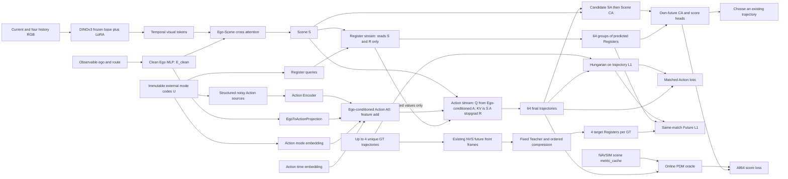

# NAVSIM Multi-GT / Multi-Future Register / One-Pass Action DiT
# v6 FINAL：恢复原图 R→Action 单向注意力的独立实施规范

**日期：2026-10-09｜规范 ID：`navsim_future_register_R_to_A_v6`。**

本文件是当前唯一需求基线，取代 v1、v2、v3、v3.1、v4、v5 及此前图文中互相冲突的默认设置。这里“FINAL”表示本轮架构和工程接口定稿，不表示已经在用户的 NAVSIM 数据上运行，也不表示性能/安全性已经证明。

**最重要的方向：Action 可以读取预测 Register；Register 不能读取 Action。**

```text
Scene S ────────────────┐
   │                   ↓
   └──→ Predicted R ──→ Action ──→ trajectory
             │                       │
             └──────→ Scorer ←────────┘
                         ↑
                       Scene
```

真实未来 RGB / Teacher Register / GT 轨迹 / metric_cache 的未来对象都不作为自由生成或评分网络的输入。未来训练目标只在匹配与 Loss 侧使用。

## 0. 给 Codex 的执行优先级

1. **先读取本文件全部内容。** 完整包中另有 `config/config_v6_final.yaml`、`CODEX_IMPLEMENTATION_PROMPT_v6.txt` 和微型测试供对照。本文件的不可变合同优先于旧图、旧 README 和旧版本文档。只收到本MD时，可按第14节内嵌配置和第16节断言重建文件，不需要历史对话；缺少随包原图/测试不允许改架构，也不能宣称在本地运行了未附的测试。参考图是 `assets/user_attention_mask_reference.png`，数值mask在本文件已完整给出。
2. 先审计现有仓库、工作区未提交改动、数据路径、DINOv3 checkpoint、NAVSIM/DrivoR fork、metric_cache 和评测版本。不要覆盖用户代码，不假造缺失数据，不先做大规模重构。
3. 先移植并运行本文件的权限/梯度合同测试，再逐模块实现。不能将随机张量微型测试通过写成“真实 NAVSIM 已验证”。
4. 严格区分“用户硬约束”“本版工程起点”“参考论文已有方法”“尚待实验证明”。对缺失配置或与真实代码不一致之处，先输出带证据的阻塞报告，不静默改方向。
5. 生成/修改项目源码是 Codex 的任务；本包提供可执行的小模型合同示例、配置及验收标准，不是完整 NAVSIM Agent 的现成实现。

---

## 1. 不可变合同：不能再把信息流画反

### 1.1 唯一允许的组级 mask

逻辑 token 顺序：`[Scene S | Action A | Future Register R]`。**行=Query，列=Key/Value，1=允许读取。**

| Query / K,V | S | A | R |
|---|---:|---:|---:|
| S | 1 | 0 | 0 |
| A | 1 | 1 | 1 |
| R | 1 | 0 | 1 |

```python
GROUP_ALLOW = [[1, 0, 0],
               [1, 1, 1],
               [1, 0, 1]]
```

- 允许的信息流：`S→R`、`S→A`、`R→A`。
- 禁止的信息流：`A→R`、`A→S`、`R→S`。
- **R–R 区域全可见，不改成时间下三角。** 所有 R 都是待预测变量，不是喂入的真实未来帧。
- A–A 区域全可见。一次输出8个未来位姿不是逐点用真实动作 teacher forcing。
- 不同候选在生成器内完全隔离；仅 Scorer 的候选比较阶段允许 candidate self-attention。

9×9 展示仅将每组画成3个格子；真实 Ns、Na、Nr 按配置展开：

```text
          S S S | A A A | R R R
S         1 1 1 | 0 0 0 | 0 0 0
S         1 1 1 | 0 0 0 | 0 0 0
S         1 1 1 | 0 0 0 | 0 0 0
          ------+-------+------
A         1 1 1 | 1 1 1 | 1 1 1
A         1 1 1 | 1 1 1 | 1 1 1
A         1 1 1 | 1 1 1 | 1 1 1
          ------+-------+------
R         1 1 1 | 0 0 0 | 1 1 1
R         1 1 1 | 0 0 0 | 1 1 1
R         1 1 1 | 0 0 0 | 1 1 1
```

### 1.2 三类边界必须分别实现

**数据边界**：未来 RGB、Teacher R、GT、PDM label 只属于 targets/oracle，不属于学生 observation。`R_GT.detach()`仍含答案，禁止送入模型。

**前向边界**：R 不读取 Action token、Action hidden、预测速度、预测轨迹、Scorer state，也不能通过被 Action 改写的 Scene、全局池化、归一化或可变 KV cache 绕回。不要新增 `P(S, predicted_trajectory)` 来“补全”未来；那会改变本合同。

**反向边界**：主方案中 Action 消费 `R_memory.detach()`；Scorer 消费 `S.detach(), trajectory.detach(), R_pred.detach()`。因此 Action Loss 不训练 R 专属分支，Score Loss 不训练 Scene/Action/R。R 的视觉知识来自配对未来 L1，而不是评分梯度。

训练后的共享 Scene 参数会受合法视觉监督更新，下一步 Action 因而变化，这是监督学习，不是本次前向读取了未来。不能把所有参数学习影响都误称为数据泄漏。

### 1.3 立即删除/拒绝的旧设置

| 旧设置 | v6处理 |
|---|---|
| v5 的 `A不能看R / R读取最终A` | 撤回，恢复本节 mask |
| v4 的 `coarse τ→P→refine τ→P` | 不作为主结构；不运行轨迹到R的反向反馈 |
| `P(S, GT trajectory)`精确未来辅助预测器 | 不加入本模型，避免另开 A→R 通道 |
| GT 或 GT未来用于R初始化 | 禁止；GT只决定监督分配 |
| 64组R全部相同的初始化 | 改为同一外部模式条件 U 的候选独立初始化 |
| `score→R predictor`受控/不受控梯度 | 都关闭 |
| 动态EMA Teacher + 永久静态特征缓存 | 禁止混用；主方案固定Teacher |
| 预缓存固定64条网络轨迹分数 | 不替代当批在线监督 |
| 根据未来L1误差/GT质量给Scorer门控 | 禁止；这些是训练目标侧信息 |

---

## 2. 这到底是哪一种模型：共享模式条件下的配对预测

### 2.1 一个必须承认的结构取舍

本模型不是 `P(S, 最终轨迹)→精确后果` 的 action-conditioned world model；因为那会让 R 读取 Action。它是**共享模式条件下的 trajectory–future 配对预测器**：

\[
\hat R_m=f_\phi(S,U_m),\qquad
\hat y_m=g_\theta(S,Z_m,U_m,\operatorname{sg}[\hat R_m]).
\]

`U_m` 是前向开始前就确定的外部模式代码；`Z_m` 是该模式的结构化动作初值及动作侧小噪声。R 和 Action 共享模式身份，但没有 Action 激活流入 R。

因此配对关系来自三个因素：**共同 U、R→Action 条件连接、同一 GT pair 的共同匹配监督**。

不能同时宣称：R 严格不读 Action，却又由最终 Action 唯一确定。相同最终轨迹来自不同 U 时，R 不必相同；这不是本模型应通过的测试。正确测试是：**固定 S/U，改变 Action 输入或 Action 参数，R 必须不变。**

### 2.2 预测未来不等于真实未来

R 是该候选模式的“未来视觉假设”，不是 oracle，不保证等于实际执行生成轨迹后的世界。候选尚不准确时，trajectory 与 R 的物理一致性可能不足，需要验证，不能靠候选下标证明。

Hungarian 对 `(predicted trajectory, predicted R)` 这个配对输出指定 `(GT trajectory, target R)`。这是集合预测的目标回归，不是在断言当前尚未收敛的预测轨迹已经拥有精确的视觉真值。

只有K组未来目标，不能声称全部64组预测未来都被真实/合成图像逐一监督。Scorer可读取预测 R，但保留 Scene/Trajectory 路径，允许降低不可靠未来的作用。

### 2.3 为什么仍然能利用多未来监督

对于同一场景，4条不同 GT 各有自己的4个未来 Register。模型的4个匹配模式分别学习对应 pair，不将4套未来平均成一套。R 作为 Action 能读取的条件，还会参与动作生成；最终同一候选的预测 R 会进入 Scorer。

这保留用户的两个目标：**Future 参与生成；Future 参与选择。** 不再退化为仅在动作生成后预测未来的 v5 路径。

---

## 3. 数据合同：NAVSIM、历史、Multi-GT、Multi-Future

### 3.1 可观测输入 Observation

- 当前及4个历史时刻：`[-2.0,-1.5,-1.0,-0.5,0.0]s`。
- 默认前视；保留 `cameras` 列表扩展。多个相机与多个GT是不同维度，禁止混淆。若现有项目已采用多相机输入，P0应继承并记录实际相机列表；不能因为配置示例写front就静默删除其他当前/历史相机。
- Ego速度、加速度、相对历史位姿、合法导航指令只来自 t0 及以前可得数据。
- 历史缺帧返回 `history_valid`。可用过去可见帧作padding，但mask必须保留；不能用未来补帧或跨scene借帧。
- 图像时间、相机内外参和相对运动编码使用一致坐标。轨迹为 `ego-at-t0` 下的米/弧度。
- `metric_cache` 内部的未来agents、地图评估状态和GT质量不作为网络输入。

```python
@dataclass
class Observation:
    rgb_history: Tensor       # [B,5,V,3,H,W]
    history_valid: Tensor     # [B,5,V]
    ego_history: Tensor       # [B,5,De]
    route_command: Tensor
    relative_ego_poses: Tensor
    camera_metadata: object   # ONLY calibration available before/at t0
```

模型接口不能接收整个混合 batch 字典；只传上面的可观测字段。

### 3.2 每个场景的配对 Targets

```python
@dataclass
class PairTargets:
    gt_trajectory: Tensor       # [B,Kmax,8,3], x/y/yaw
    gt_encoded: Tensor          # [B,Kmax,8,4], same codec as model
    gt_valid: Tensor            # [B,Kmax]
    future_register: Tensor     # [B,Kmax,4,d]
    future_chunk_valid: Tensor  # [B,Kmax,4]
    future_quality: Tensor      # [B,Kmax,4], target/loss only
    pair_ids: object
```

Kmax=4、K_eff可为0/1/2/3/4。0个轨迹GT的scene不算Action/Future loss，但合法oracle仍可监督Scorer；大量缺标情况须报告。轨迹存在、未来图缺失时不能删除合法轨迹目标。

每条pair至少存储：

```text
scene_id / split / t0_timestamp / gt_id / original_gt_id
trajectory_path / trajectory_coordinate_frame / trajectory_pose_hash
future_rgb_paths / future_times_s / future_camera_id
camera_calibration_hash / render_world_version
frame_valid / chunk_valid / quality
teacher_checkpoint_hash / compressor_hash / target_cache_path
```

`original_gt_id`相同的复制项只算一个GT。近重复轨迹应诊断并通过明确阈值去重；不使用k-means生成GT，不用简单copy制造多模态。

### 3.3 外部未来帧接口

```python
class FutureViewProvider:
    def get(self, scene_id, gt_id, timestamps_s, camera_id='front'):
        # RGB[8,3,H,W], frame_valid[8], quality[8], camera_poses[8,4,4], metadata
        ...
```

优先读取已有的帧；NVS只允许离线预生成。外部数据必须匹配 scene、GT pose、时间、相机和 world timeline；不允许把同名但不对应的图强行当target。

对每条GT分别操作，不将不同 GT 的 future images 做 pooling。主“multi-future view”指不同GT路径对应的未来前视图，而不是把左/右/前物理相机当成不同GT。

### 3.4 时间和动态世界一致性

未来4s按2Hz取8张：`+0.5,+1.0,...,+4.0s`。每两帧构成一个1秒bin中的两个采样点：

| future bin | 采样时刻 | 输出 |
|---|---|---|
| (0,1]s | 0.5、1.0 | R[k,0] |
| (1,2]s | 1.5、2.0 | R[k,1] |
| (2,3]s | 2.5、3.0 | R[k,2] |
| (3,4]s | 3.5、4.0 | R[k,3] |

两张相邻图之间差0.5s；不要再写“每2秒的2帧”。

NVS若重放logged agents，PDM也需使用同一场景时间线；NVS不自动模拟其他交通主体对自车的反应。有限但危险的轨迹可以是负样本，NVS缺失/黑帧/鬼影则要mask未来目标。模型不能获得前视图不可见区域的确定性安全保证。

---

## 4. Teacher目标：固定DINOv3；Student用LoRA

### 4.1 主方案，不再在EMA/frozen之间含糊切换

- Student当前/历史DINOv3：预训练base冻结，LoRA训练。
- Future Teacher：独立固定的同架构预训练DINOv3；不挂随Student更新的LoRA，不与Student共用可写状态。
- Teacher始终 `eval()`、`requires_grad_(False)`、离线 `no_grad()`。
- 默认不使用动态EMA。选择固定Teacher是为了静态目标可缓存及计算可控，不代表必然精度更高。
- 动态EMA只作为另立配置的消融；不得边更新Teacher边永久使用旧特征。不得在主配置中悄悄启用。

### 4.2 每GT 8帧压为4个Register

1. 每帧经固定Teacher得到patch feature grid。
2. 固定2×2空间分区pool，保留区域顺序。
3. 每个chunk将 `[早帧四区; 晚帧四区]`按顺序拼接，不作无序两帧均值。
4. 只在train split拟合PCA/固定线性压缩至d=256，冻结均值、投影、归一化并保存hash。
5. 每个chunk一个向量，最终每GT `[4,256]`；两个帧都有效才默认启用该chunk目标。

压缩器也是目标定义的一部分；更新压缩器必须重建cache。小样本烟测不够拟合PCA时可用固定种子的测试投影，但必须标为 `synthetic_smoke_only`，正式训练不混用。

4个Register是用户指定预算，不是信息充分性保证。PCA可能丢失罕见风险线索，需有4/16 tokens与空间分区的容量消融。时间embedding加到查询中，而不是把时间编码作为主要重建目标制造低Loss假象。

DINO自带register、历史压缩memory、本项目4个未来Register是三个不同概念。

---

## 5. Scene编码与不可变共享模式 U

### 5.1 Scene / Ego融合

5帧共享DINOv3-LoRA；追加time、camera、relative ego-motion embedding。当前帧保留空间特征，历史压为较小memory。建议起点：当前32+历史4×8+融合ego2=66个tokens，真实数量由配置而非图中小方格决定。

Ego query与视觉memory做一次Cross-Attention，再保留视觉token：

```python
V = temporal_fusion(student_dino_lora(obs.rgb_history), obs.history_valid,
                    time_embeddings, relative_pose_embeddings)
E_clean = ego_mlp(obs.ego_history, obs.route_command)
E_fused = cross_attention(query=E_clean, key=V, value=V)
S0 = projection(cat([V, E_fused], dim=token_axis))
```

`E_clean`只由可观测 Ego 历史/当前状态及既有 route command 路径产生；它也是 Action 条件的共享 clean 表征。Action 专属投影发生在 `E_clean` 之后，混入 Action 的 hidden 不得返回 Scene/Register。若 Ego MLP 输出多 token，先显式池化为 `[B,d_model]` 再做 Action 投影与候选/时间广播。

不要把全部视觉压成2个示意ego token。Student base冻结不等于整个前向 `no_grad()`；LoRA需要梯度。Student features随LoRA更新，不能永久缓存代替当前编码。

### 5.2 为什么必须增加候选独立条件

在本mask下，若64份R初始完全一致，S又相同，则R不会因不同Action而自动分化。因此每个候选都有自己的外部模式代码U。

```text
Immutable U_m ──→ R initialization
      └────────→ Action source/initialization
```

这是共同上游，不是Action到R的边。约束：

- U为前向开始前固定的8×8模式代码buffer，来自配置及合法观测相关source规则，不来自GT选择或网络预测。
- R初始化只接U和4个可学习时间查询；Scene通过后续注意力进入。
- Action有自己的U投影，与R的U投影参数不能共享；避免Future loss经共享mode embedding更新Action专属参数。
- 不从Action token/Action MLP结果/最终轨迹反推U；不将 `(z_m或tau_m).detach()`偷偷塞入R。
- 候选重排时U、source、输出一起重排。U不是GT编号，也不承诺固定列永远对应“左转GT”。

```python
R0[m,c] = learnable_future_query[c] + embed_U_for_R(U[m])
e_action = ego_to_action_projection(pool_if_needed(E_clean))
A0[b,m,j] = (embed_action(Z[b,m,j]) + e_action[b]
             + action_time[j] + embed_U_for_A(U[b,m]))
```

这里的 `+` / `⊕` 是同维特征相加，不是把原始 Ego 数值加到轨迹坐标。`Z` 仍是原结构化 noisy Action source；噪声只进入 `Z`，不进入 `E_clean`、Scene 或 Register。不得重复 time/mode embedding，也不得用 GT 初始化 Action。候选数和时间步来自实际配置，不硬编码64/8。

固定S/U，只修改动作噪声或动作状态，R保持不变；同时，修改U可使R/Action都变化。这是两个不同的干预测试。

### 5.3 64个动作初值

优先复用用户已有8×8初始化器，但必须检查仅依赖观测/配置且返回固定顺序64个anchors。若不存在，可启用明确记录的fallback：8个纵向目标速度偏移×8个转向强度；以合法ego当前速度和固定参数构造4秒运动原型。建议代码将模式参数保存为U，将生成的clean轨迹编码为Z_clean。

一个可实现fallback起点：速度偏移 `[-4,-2,-1,0,1,2,3,4] m/s`；目标yaw-rate `[-0.30,-0.18,-0.08,0,0.04,0.08,0.18,0.30] rad/s`。令v向 `clamp(v0+dv,0,v_limit)`变化，acceleration限制在配置范围；yaw-rate按横向加速度上限裁剪；固定0.1s步长生成原型，再取8个规划时刻。这只是初值构造，不是神经网络Flow积分，也不保证原型在地图上可行。所有这些值需本地profile/数据校准。

Stage2仅在Action侧向Z_clean加入小幅归一化Gaussian jitter。U/R本身不做扩散，不共享该action jitter。训练/评测记录同一source规则；评测seed固定。高噪声可能使相同U的R与Action不协调，需做jitter=0对照，不能把增大噪声当作免费多样性。

---

## 6. Action DiT内部：一个N层有向多流stack

### 6.1 模块和参数组

| 参数组 | 内容 | 允许梯度 |
|---|---|---|
| eta | Student LoRA、clean Ego MLP、历史/Ego融合、Scene独立更新层 | Action Loss、Future L1 |
| phi | R查询、R的U投影、R attention/FFN、R输出投影 | Future L1 |
| theta | Action编码/U投影、Action专属 EgoToActionProjection、Action attention/FFN、轨迹头 | Action Loss |
| psi | Scorer候选/场景/自身未来注意力、门控、六头 | Score Loss |
| fixed | DINO base、Teacher、目标压缩器、U buffer | 无 |

模块 I/O（Action 输入修正后的真实边界）：

| 模块 | 输入 | 输出/用途 |
|---|---|---|
| clean Ego MLP（eta） | 可观测 `ego_history`、既有 `route_command` | `E_clean [B,d]`；供 Scene 与 Action 前投影共享 |
| Scene Encoder（eta） | RGB/history、`E_clean` | `S [B,Ns,d]`；保留既有 Ego→Scene clean 融合 |
| EgoToActionProjection（theta） | `pool_if_needed(E_clean)` | `e_action [B,d]`；只广播到 A0 |
| Action initializer（theta） | `Z [B,M,Na,4]`、U、time、`e_action` | Ego-conditioned `A0 [B,M,Na,d]` |
| Register initializer（phi） | 外部 U、future queries | `R0 [B,M,Nr,d]`；不读 Action/EgoToActionProjection |

除显式共享的clean Ego/Scene eta外，theta/phi/psi不得共享可训练参数。Action专属投影不得复用于Register。单一PyTorch模块名 `ActionDiT` 不等于所有分支强制共享QKV/FFN参数。

### 6.2 每层的精确执行顺序

逻辑布局保持 `[S|A|R]`。为把权限做成显式接口，采用分组执行；第l层：

\[
S^{l+1}=B_S^l(Q=S^l,KV=S^l),
\]
\[
R_m^{l+1}=B_R^l(Q=R_m^l,KV=[S^{l+1},R_m^l]),
\]
\[
\bar R_m^{l+1}=D_R(R_m^{l+1}),
\]
\[
A_m^{l+1}=B_A^l(Q=A_m^l,KV=[S^{l+1},A_m^l,sg(\bar R_m^{l+1})]).
\]

每个B包含pre-tokenwise-LayerNorm、多头Attention、残差、tokenwise FFN。D_R是跨深度复用的轻量投影，最后的 `bar_R^N` 同时是Future监督输出和Scorer输入；Action最后一层也能读取它。

**块内顺序是S更新→R更新→A更新；N层只遍历一次。** 这是原组级权限的有向分组实现，不声称与使用共享参数、同步更新全部token的一次大self-attention数值完全相同。

- S只按B维计算，不因M=64重复Scene self-attention。
- R/A按 `[B*M,...,d]`运行；R的KV物理上只有S/R，没有A。
- Action的单次attention中，KV按 `[S,A,R]`排列并共享一次softmax。不要随意拆成三次attention却声称完全等价。
- 分组可省掉一定无用计算，但需要实际profile。
- R–R全可见；任何图中“causal register”字样删除。
- LayerNorm只沿通道维，不能用跨候选BatchNorm、跨token全局池化给R提供Action统计量。

### 6.3 参数更新与前向信息不是同一回事

Action用 `bar_R.detach()`，仍然能读取R的数值，因此R能改变轨迹；只是Action Loss不改phi。Score输入的S/trajectory/R都detach，Scorer里自己的Future K/V投影仍然是可训练参数。

Mask阻止的是R读取Action数值；detach阻止的是特定Loss回传。两者都必须验证，不能互相替代。[R4,R5]

### 6.4 推理函数签名

```python
pair_outputs = model.forward_pairs(observation, noisy_action_sources, immutable_mode_codes)
# outputs: scene_context, endpoint, decoded_trajectory, predicted_register
```

不能增加 `gt_trajectory`、`teacher_register`、`future_rgb`、`oracle_score`参数。Scorer只从这次输出读入预测值，不触发生成器再次修改轨迹。

### 6.5 输出与速度残差

用归一化 `y[j]=[x/sxy,y/sxy,sin(yaw),cos(yaw)]`，T=8。模型输出端点，可用残差读出：

\[
\hat y_m=Z_m+W_A(A_m^N),\qquad \hat v_m=\hat y_m-Z_m.
\]

对于匹配GT k：

\[
v^*_{m,k}=y_k^{GT}-Z_m,
\qquad \|\hat v_m-v^*_{m,k}\|^2=\|\hat y_m-y_k^{GT}\|^2.
\]

这是source到endpoint的残差，不是车辆实际m/s。在同一个未decode空间中损失等价；不能把不同归一化/角度decode混进等式。

主训练不随机采flow-time，不构造含GT的插值输入，不积分，不额外no_grad生成64条再重跑匹配winner。N层是网络深度，不是去噪步数。正式方法口径为**one-pass paired set prediction / residual-velocity regression**；保留DiT代码框架不代表完整连续Flow Matching。标准FM训练本来无需每个训练样本积分到终点。[R6]

Decode：乘回固定xy尺度，atan2恢复yaw；sin/cos范数极小时用source yaw作明确fallback并记录频率，禁止读取GT纠正。训练/评测都用相同decode。

---

## 7. 数据流图：真未来不进入学生



图中的 Action 入口 `feature add`（即 `⊕`）是同维 hidden feature 相加，不是原始状态与轨迹坐标相加；该入口图不替代第6.2节完整的 `[S,A,stopgrad(R)]` K/V顺序和v6 mask。LA/LR/LS是终端监督节点，不画成网络condition箭头。省略detach的小图旁应注明它们在代码中按第10节执行。

---

## 8. Hungarian与配对损失：只算一次匹配

### 8.1 Stage2轨迹匹配

将当次64条自由预测轨迹detach，仅用物理xy位置建立成本：

\[
C_{k,m}=\frac1{8}\sum_j\|\hat p_{m,j}-p_{k,j}^{GT}\|_1.
\]

使用 `scipy.optimize.linear_sum_assignment` 解每scene矩形匹配，输出 `[(gt_index,candidate_index)]`。不使用PDM、不使用未来latent距离、不使用GT分数来挑winner。

Hungarian是全局总成本最小的一对一分配，不是四次独立argmin。四个有效不同GT对应四个不同候选；复制GT先去重。索引无梯度，gather后从**原始带梯度输出**计算loss。

Hungarian根据预测Action决定哪个R接受哪个目标，这是**前向结束后的监督分配**，不是把Action送回R网络。其索引不进入自由前向、不提供连续梯度。干预测试必须比较原始U顺序的R输出，而不是经不同匹配重新排序后的R。固定参数且在optimizer.step之前验证不泄漏；合法的监督参数更新不属于同次前向泄漏。

### 8.2 Action Loss

\[
L_A=\operatorname{mean}_{b:K_b>0}\frac1{K_b}
\sum_{k=1}^{K_b}\operatorname{mean}_{j,d_a}
\left[(\hat y_{b,\pi_b(k)}-Z_{b,\pi_b(k)})-(y^{GT}_{b,k}-Z_{b,\pi_b(k)})\right]^2.
\]

未匹配60条不强行使用同一GT。全无GT返回可微零并记录；无效padding含NaN时，在cost和loss前筛除。

### 8.3 Future L1使用完全相同的pi

令第k个GT的第c个chunk质量/有效权重为 `w[k,c]`，逐chunk的d维L1均值为e：

\[
e_{k,c}=\operatorname{mean}_d|\hat R_{\pi(k),c}-sg(R^{GT}_{k,c})|,
\]
\[
\ell_k^R=\frac{\sum_c w_{k,c}e_{k,c}}{\sum_c w_{k,c}},\qquad
L_R=\operatorname{mean}_{scene}\operatorname{mean}_{k:\sum w>0}\ell_k^R.
\]

先对每GT有效chunks平均，再对scene内有效GT平均，再对有效scene平均。不能让future多或复制多的scene自动放大权重。

- 轨迹GT存在但future不可用：照算L_A，跳过其L_R。
- 不单独给future再次求winner；否则pair断开。
- NVS quality只给L_R，不能给Scorer作条件，也不用于挑最高PDMS的GT。
- 不强制视觉相似的GT在latent中彼此远离；不默认加contrastive/mode排斥损失。
- 模式塌缩通过assignment频率、可达mode计数、oracle-best64等检查；不靠“64个数组”自称64种驾驶方式。

### 8.4 为什么这里可以直接用共同匹配监督R

R预测的是模式U的未来假设，Action是读取该R后给出的同模式动作；二者一起接受完整GT pair作为输出目标。它不同于v4/v5的 `P(S,具体预测轨迹)`，后者若输入轨迹不等于GT却用GT未来监督，会有条件错配。

这里没有声明预测轨迹已经等于GT，只是要求配对输出一起向同一目标收敛。仍要实测trajectory–future一致性，不能把索引绑定当物理保证。

---

## 9. Scorer：DrivoR源码架构随机初始化，读取NVS DINOv3 Scene

### 9.1 结构与输入

默认/真实训练使用 `ScratchDrivoRScorer`，只复用官方DrivoR源码的 `TransformerDecoderScorer`、`Scorer`、loss和selection公式；不得加载任何DrivoR scorer state dict，也不得构建/缓存native DINOv2 Scene或native Ego token。`NativeDrivoRScorer`仅可作为显式对照工具。

```text
64 decoded trajectories [B,64,8,3] (detached)
    → Linear(8*3,1024) → ReLU → Linear(1024,256), scratch random init
    → 4-layer official candidate self-attention
    → official cross-attention, K/V = detached NVS scene_context [B,66,256]
    → add mean(scene_context[:, -2:, :]) as NVS ego-fused token
    → official six independent heads [NC,DAC,DDC,TTC,EP,C]
```

Scorer的Scene K/V必须是同一次 `DirectedPairDiT.forward_pairs()` 返回的NVS DINOv3 `scene_context`。最后两个token是NVS clean Ego/Scene融合query，明确取均值后做Ego addition。trajectory与Scene均在边界detach。当前v6合同下predicted Future Register不作为严格DrivoR scorer输入，不增加Future CA/gate。

### 9.2 Score到底监督谁

`L_C`监督所有64条轨迹的执行质量，只更新scratch scorer的trajectory projection、四层decoder和六heads；**不更新eta/Scene、theta/Action或phi/Register**。Stage1冻结全部scorer参数，Stage2才解冻；两个optimizer必须参数完整、唯一、互不重叠。

### 9.3 标签和损失

Head命名统一为 `[NC,DAC,DDC,TTC,EP,C]`。主路径必须直接调用或数值严格复刻官方 `DrivoRLoss.score_loss`：NC/DDC的0.5按源码映射为0，TTC=2按源码忽略，其余为原始soft target；不得替换训练目标。raw7保持 `[NC,DAC,EP,TTC,C,DDC,Final]` 且不得被原地修改。

### 9.4 输出选优

必须继续使用DrivoR源码utility：

\[
\log \hat{NC}_m+\log \hat{DAC}_m+
\log(5\hat{TTC}_m+5\hat{EP}_m+2\hat C_m),
\]

DDC权重为0。返回其argmax对应的已有轨迹；不进行Scorer梯度搜索、不反馈重生成、不在神经网络推理时调用oracle。

---

## 10. NAVSIM metric_cache与当批在线监督

### 10.1 三种缓存不要混淆

1. `scene metric_cache`：预先制作的场景评估材料，DrivoR兼容NAVSIM格式。
2. `future target cache`：每个GT的固定Teacher视觉目标，允许离线缓存。
3. `candidate score cache`：某批固定候选的分数；**不作为主训练标签来源**。

每个Stage2 step必须用本次最终64条候选在线获得outcome labels，不能重用上一批或旧checkpoint同index的标签。

### 10.2 已核对调用链

```text
DrivoRAgent.compute_loss
 → DrivoRLoss.forward(..., scoring_function)
 → DrivoRAgent.compute_score(targets, current_proposals, test=False)
 → get_scores / get_sub_score(scene_metric_cache, current_poses, ...)
 → transform_trajectory / get_trajectory_as_array
 → PDMSimulator.simulate_proposals
 → PDMScorer.score_proposals
```

已核对源码位置：

```text
navsim/agents/drivoR/drivor_agent.py
navsim/agents/drivoR/score_module/compute_navsim_score.py
navsim/agents/drivoR/score_module/train_pdm_scorer.py
navsim/agents/drivoR/layers/losses/drivor_loss.py
navsim/agents/drivoR/transformer_decoder.py
```

`compute_navsim_score.py`当前核对到的文件blob SHA：`568c113c454b63596681603347322bc47058e8eb`；`drivor_agent.py`文件blob SHA：`883137111ef6cdeb2a7ff19ba77e5fc3ad4ecd18`。**文件blob SHA不是整个repo commit**，P0必须另记录checkout commit。

核对代码使用40个0.1s模拟采样间隔；输入规划轨迹是8个0.5s点。返回原始顺序：

```python
native_names = ('NC','DAC','EP','TTC','C','DDC','Final')
# map to model names explicitly, preserving raw7:
head_indices = [0,1,5,3,2,4]
```

Final另存；不要对raw7原地做标签转换污染日志和聚合。缓存对象字段包括ego_state、observation、centerline、route_lane_ids、drivable_area_map、pdm_progress，实际兼容性以本地版本为准。[R3]

### 10.3 Adapter合同

```python
class OnlineOracle:
    @torch.no_grad()
    def evaluate(self, scene_ids: list[str], trajectories: Tensor) -> OracleLabels:
        # trajectories: CURRENT [B,64,8,3], detached, finite, ego-at-t0
        # outputs: raw7, named_six, head_valid, final_score, final_valid,
        #          scene/proposal hashes, evaluator_version, failure_diagnostics
        ...
```

Cache路径仅oracle/data侧可见。模型不接 `scene_ids→未来cache` 的查询功能。默认按scene一次处理64条，复用scene解压对象；如果本地进度归一化依赖候选组，不可独立按16条算后拼接冒充64组评分。

PDMScorer有可变内部状态；worker进程隔离或串行保护，不让多个线程并发改写同一实例。只加载可信pickle/cache。

先同步实现正确，再测异步。异步结果必须绑定 `scene_id + exact_trajectory_hash + evaluator_version + batch_id`；不能把延迟返回的旧标签监督已经变化的新输出。

---

## 11. 两阶段：每阶段实际做什么、冻什么

### 11.1 离线准备，不算第三训练阶段

审计环境、split与metric_cache；验证GT/future一一对应；构建固定模式U和source原型规则；按固定Teacher生成4×K的目标Register缓存；fit PCA仅train；建立feature/oracle版本哈希。

### 11.2 Stage1：模式条件化的未来表征预训练

本mask不允许R读取Action，因此**撤回旧版把clean GT Action喂给P(S,GT)的设定**。Stage1用固定clean anchor仅在Loss侧建立模式对应，而不作为R的轨迹输入。

| 项目 | Stage1 |
|---|---|
| 学生输入 | 当前+历史观测、Ego、固定U；无GT/未来 |
| 模型执行 | Scene编码/tower + R分支，生成64组R；Action分支可跳过 |
| “不去噪动作”的含义 | 无Action噪声训练、无Action Loss；如需展示动作，只展示固定clean anchor，不把未训练输出当规划结果 |
| 匹配 | 用clean anchors与有效GT位置L1做一对一Hungarian；只在targets/Loss侧使用GT |
| 监督 | 对匹配模式的R，以相同GT的Teacher R做L1 |
| 冻结 | DINO基础、Teacher/压缩器、Action专属theta（含 EgoToActionProjection）、Scorer psi |
| 更新 | LoRA/Scene eta（含共享 clean Ego MLP）、R专属phi |
| Oracle | 不调用 |
| 输出 | 预训练Scene/R权重、模式匹配与未来验证记录 |

Stage1 anchor matching不等于“anchor实际执行的未来就是GT未来”；anchor只用于给模式U分配该scene的监督目标。这是模式预训练，不是精确物理轨迹条件预测。

Stage1和Stage2的R前向始终只读S/U/R，不需要GT→source的教师强制切换。Stage2的匹配对象从fixed anchors变成预测轨迹，因此仍可能有模式重分配；日志应记录，而不是宣称没有任何分布变化。

Stage1退出门槛：合法held-out validation pair loss和模式条件性优于constant/scene-only对照；GT/future互换负对照有效；训练参数符合冻结表。不是“train L1下降就算成功”。

### 11.3 Stage2：配对生成 + Future L1 + 在线全64 Scorer

| 项目 | Stage2 |
|---|---|
| 学生输入 | 可观测O、immutable U、64个带小噪声source Z |
| 一次执行 | N层按S→R→A的块内顺序遍历一次，输出64组端点/R |
| 模型输出 | S_final；encoded y_hat；decoded tau64；R_pred64 |
| 匹配 | 对tau64.detach与GT做Hungarian |
| Action监督 | 至多K个匹配winner的残差速度/端点MSE |
| Future监督 | 同一pi、同一GT pair的匹配R L1 |
| Scorer输入 | detach(S_final, tau64, R_pred64) |
| Scorer标签 | 当批tau64 + scene metric_cache在线得到64条PDM分项 |
| 冻结 | DINO base、Teacher和目标压缩器；U buffer固定 |
| 更新 | eta、theta（含 Action 专属 EgoToActionProjection）、phi、psi；但按下表指定Loss来源 |
| 不做 | 额外物理轨迹到R预测器、GT前向、双流扩散、多轮完整采样、固定候选score缓存 |

总目标：

\[
L_1=\lambda_{R,1}L_R^{anchor\ matching},
\]
\[
L_2=\lambda_A L_A^{predicted\ matching}
+\lambda_{R,2}L_R^{same\ matching}
+\lambda_C L_C^{all64}.
\]

Stage1与Stage2不共享optimizer动量状态是允许的；应复用模型权重并为解冻组新建优化器/明确状态策略。Stage2从开始运行online all64；若早期candidate数值坏，修复初始化或报错，不能默默只给4条评分。

### 11.4 最终梯度表

| Loss | eta：LoRA/Scene | theta：Action | phi：Register | psi：Scorer | Teacher/base |
|---|---:|---:|---:|---:|---:|
| Stage1 Future L1 | 是 | 否 | 是 | 否 | 否 |
| Stage2 Action Loss | 是 | 是 | 否：A读sg(R) | 否 | 否 |
| Stage2 Future L1 | 是 | 否 | 是 | 否 | 否 |
| Stage2 Score Loss | 否 | 否 | 否 | 是 | 否 |

eta接受Action/Future两种合法学习信号，存在多任务竞争可能，需监控梯度；不声称所有Loss绝不冲突。Action Loss可经 `EgoToActionProjection` 更新theta并继续更新共享 clean Ego MLP；Future Loss可更新共享 clean Ego MLP，但不得触达Action专属投影。Score侧若读取共享Ego也必须detach。严禁theta/phi参数重叠，让Future Loss经共享权重更新Action专属层。

---

## 12. 核心伪代码：给Codex的实现依据

### 12.1 生成与Register-only路径

```python
# U is immutable/exogenous; model methods cannot access Targets or metric_cache.
def forward_pairs(obs, source, U):
    E_clean = ego_mlp(obs.observable_ego_history, obs.route_command)
    S = scene_encoder(obs, clean_ego=E_clean)
    e_action = ego_to_action_projection(pool_if_needed(E_clean))
    A = (action_encoder(source) + e_action[:, None, None, :]
         + action_time_embedding[None, None, :, :]
         + action_mode_embedding(U)[:, :, None, :])
    R = register_init(U)
    for block in directed_blocks:  # depth, NOT diffusion solver steps
        S = block.scene_update(S)  # only S
        R = block.register_update(R, scene=S)  # KV contains only S/R
        R_memory = register_readout(R)
        A = block.action_update(A, scene=S, register=R_memory.detach())
    endpoint = source + action_residual_head(A)
    trajectory = codec.decode(endpoint)
    return PairOutputs(S, endpoint, trajectory, register_readout(R))

def forward_register_only(obs, U):
    E_clean = ego_mlp(obs.observable_ego_history, obs.route_command)
    S = scene_encoder(obs, clean_ego=E_clean)
    R = register_init(U)
    for block in directed_blocks:
        S = block.scene_update(S)
        R = block.register_update(R, scene=S)
    return register_readout(R)
```

两条路径的R应在固定参数、相同obs/U、dropout关闭时数值一致。Register-only不能因省略Action而改变R，这是强不变量。

### 12.2 Stage1

```python
def stage1_step(obs, targets, model, optimizer):
    assert_stage1_freeze_rules(model)
    optimizer.zero_grad(set_to_none=True)
    U = model.mode_buffer.expand_for_batch(obs)
    R_pred = model.forward_register_only(obs, U)
    with torch.no_grad():
        clean_anchors = model.source_initializer.clean(obs, U)
        pi = hungarian_xy(codec.decode(clean_anchors), targets.gt_trajectory,
                          targets.gt_valid)
    loss_R = paired_future_l1(R_pred, targets.future_register.detach(), pi,
                             targets.future_chunk_valid, targets.future_quality)
    loss_R.backward()
    verify_gradient_groups(model, expected={'scene', 'register'})
    clip_gradient_groups(model)
    optimizer.step()
    return detached_logs(loss_R, pi)
```

### 12.3 Stage2

```python
def stage2_step(obs, targets, scene_ids, model, scorer, oracle, opt_gen, opt_score):
    # opt_gen = eta + theta + phi; opt_score = psi. No overlapping Parameter IDs.
    opt_gen.zero_grad(set_to_none=True)
    opt_score.zero_grad(set_to_none=True)
    U = model.mode_buffer.expand_for_batch(obs)
    Z = model.source_initializer.noisy(obs, U)
    out = model.forward_pairs(obs, Z, U)       # ONE full64 generation pass
    require_finite_predictions(out)

    # Same immutable outputs are used for both labels and scorer.
    pred_score = scorer(out.scene.detach(), out.trajectory.detach(),
                        out.register.detach())
    with torch.no_grad():
        online = oracle.evaluate(scene_ids, out.trajectory.detach())
        pi = hungarian_xy(out.trajectory.detach(), targets.gt_trajectory,
                          targets.gt_valid)
    loss_A = paired_residual_velocity_mse(out.endpoint, Z, targets.gt_encoded, pi)
    loss_R = paired_future_l1(out.register, targets.future_register.detach(), pi,
                             targets.future_chunk_valid, targets.future_quality)
    loss_C = scorer.source_loss(pred_score, online)  # official DrivoRLoss.score_loss

    # Finish backward before ANY optimizer step; do not retain stale graphs.
    (loss_A + cfg.lambda_R * loss_R).backward()
    (cfg.lambda_C * loss_C).backward()
    clip_and_check_gradients(model, scorer)
    opt_gen.step()
    opt_score.step()
    return detached_logs(loss_A, loss_R, loss_C, pi, online)
```

`out.register`没有经过tau回填/readout，并且当前v6 scorer明确忽略它。Scorer训练模块自己负责Scene/trajectory输入detach，调用端也保留detach作为显式合同。

### 12.4 推理

```python
@torch.no_grad()
def predict(obs):
    U = mode_buffer.expand_for_batch(obs)
    Z = source_initializer.noisy(obs, U, generator=fixed_eval_rng)
    out = model.forward_pairs(obs, Z, U)
    logits = scorer(out.scene, out.trajectory, out.register)
    utility = benchmark_compatible_aggregation(logits)
    selected = utility.argmax(dim=1)
    return gather_existing_trajectory(out.trajectory, selected)
```

不调用GT provider、Teacher、future cache或metric_cache；不反馈重新生成轨迹。

---

## 13. 数值、并行和效率要求

### 13.1 Attention实现

主实现可用float additive bias：允许=0，屏蔽=-inf；不能误用API bool方向。PyTorch SDPA的bool True表示允许，MHA的attn_mask bool True表示禁止。[R5]

每query至少有一个合法key；历史mask全空时使用明确的当前有效帧/合法empty token，并记录，不送全-inf行。LayerNorm沿通道维，禁用跨候选统计的BatchNorm。

R/A KV投影参数在各自分支内；不要把Scene、Action、Register先做全局均值再用于R/A的AdaLN。噪声level（若仅恒定t0）只能用于Action，不通过它读取GT路径。

### 13.2 候选并行

- DINOv3五帧与Scene每scene只提一次。
- Scene tower不因64候选重复计算；R4query、A8query在候选维并行。
- 显存不足可分候选chunk，但Scorer candidate SA必须在完整64条上运行；R未来CA可在candidate维chunk。
- Oracle按完整64组处理，不能因神经网络chunk改变评测归一化语义。
- 64并行不等于1条FLOPs。需记录encoder、scene/R/A tower、scorer、oracle、backward、全step wall-clock、GPU/CPU RAM。
- 一个N层网络前向不等于标准FM在t0训练自动得到最优一步生成。2/4-step对照必须用相应FM目标另训练，不拿t0-only网络在未训练t上积分。

### 13.3 DDP与梯度累积

两个stage/不同batch的future有效性会造成未使用分支；明确设置DDP未使用参数策略，不用伪label填充。无future时返回依赖R输出的可微零，注意weight decay即便零梯度也可能更新参数；若要完全不更新某组，应跳过该组step/将grad置None并验证。

在同一逻辑batch完成所有匹配和labels后再backward；累积梯度期间每个microbatch也只评价其真实输出。两个optimizer参数ID不能重叠，所有backward在step前完成；C无连接到生成图，不需要 `retain_graph=True`。

混合精度对attention/MLP可用BF16，匹配距离与loss归一化在FP32，oracle传CPU float64/所需精度。teacher target预处理固定，不因自动数据增强随机漂移。

---

## 14. 张量合同和默认配置

| 字段 | 形状 |
|---|---|
| observation RGB | B×5×V×3×H×W |
| scene context | B×Ns×d，起点Ns=66、d=256 |
| immutable U | B×64×2，buffer/broadcast |
| clean/noisy encoded source Z | B×64×8×4 |
| Action hidden | B×64×8×d |
| Register hidden / predicted R | B×64×4×d |
| predicted endpoint | B×64×8×4 |
| decoded trajectory | B×64×8×3 |
| GT trajectory/encoded | B×Kmax×8×3 / B×Kmax×8×4 |
| GT future target | B×Kmax×4×d |
| GT / future validity | B×Kmax / B×Kmax×4 |
| score logits / named targets | B×64×6 |
| native oracle raw output | B×64×7（核查fork） |

完整机器配置既在 `config/config_v6_final.yaml`，也内嵌如下，便于只持有本MD时直接重建。未填的checkpoint、manifest、commit、cache路径为**真实部署前必须完成项**，不能用虚构文件替代。

训练深度、LoRA rank、learning rate、loss权重、门控和source幅度都是实验起点，不是参考论文原参数或已验证最优值。

加载配置时硬断言本节mask；如果出现 `physical_trajectory_to_register_readout=true`、`register_reads_action=true`、`action_reads_register=false`、`register_self_causal=true`、`score_updates_register=true`，立即报错而非兼容旧v5逻辑。

### 14.1 完整可复制配置（与随包YAML一致）

```yaml
# Experimental starting values, not validated optimums.
spec_version: '6.0'
spec_id: navsim_future_register_R_to_A_v6
benchmark:
  name: navsim_v1
  navsim_commit: null               # REQUIRED: filled by repository audit
  oracle_source_commit: null        # REQUIRED: repository commit, not blob hash
  metric_cache_root: ${NAVSIM_EXP_ROOT}/train_metric_cache
  train_split_manifest: null        # REQUIRED: audited paths; never synthesize missing data
  validation_split_manifest: null
  test_split_manifest: null
observation:
  cameras: [front]                  # configurable; use calibrated camera IDs from local data
  times_s: [-2.0, -1.5, -1.0, -0.5, 0.0]
  history_frames: 4
  history_valid_mask: true
  ego_time_limit_s: 0.0
future_target:
  source: precomputed_front_rgb
  camera: front
  times_s: [0.5, 1.0, 1.5, 2.0, 2.5, 3.0, 3.5, 4.0]
  chunks: [[0.5, 1.0], [1.5, 2.0], [2.5, 3.0], [3.5, 4.0]]
  registers_per_chunk: 1
  registers_per_gt: 4
  max_unique_gt: 4
  teacher: fixed_frozen_dinov3
  teacher_checkpoint: null
  target_dim: 256
  compression: ordered_2x2_spatial_pool_then_train_only_frozen_pca
  target_cache_root: null
  online_nvs: false
  teacher_targets_as_model_inputs: false
vision:
  backbone: dinov3
  checkpoint: null
  base_trainable: false
  student_lora:
    enabled: true
    rank: 16
    alpha: 16
    dropout: 0.0
    candidate_modules: [qkv, proj]   # bind only after inspecting real backbone modules
  current_scene_tokens: 32
  history_tokens_per_frame: 8
  fused_ego_tokens: 2
  scene_tokens: 66
  whole_student_no_grad: false
  permanent_student_feature_cache: false
modes:
  count: 64
  grid: [8, 8]
  initializer: audited_existing_8x8_or_v6_fallback
  shared_code: immutable_exogenous_2d_U
  shared_trainable_mode_embedding: false
  codebook_is_buffer: true
  codebook_hash: null
  source_uses_gt: false
  action_jitter_std_normalized: 0.02
  eval_jitter_std_normalized: 0.02
  eval_seed: 17
model:
  d_model: 256
  heads: 8
  ffn_dim: 1024
  depth: 8
  action_tokens: 8
  register_tokens: 4
  token_order: [scene, action, register]
  group_allow: [[1, 0, 0], [1, 1, 1], [1, 0, 1]]
  action_reads_register: true
  register_reads_action: false
  register_self_causal: false
  block_schedule: scene_then_register_then_action
  register_init_inputs: [learned_time_queries, immutable_mode_code]
  action_init_inputs: [source, immutable_mode_code, action_time_embedding, projected_clean_ego]
  clean_ego_source: [observable_ego_history, route_command]
  clean_ego_shared_before_action_projection: true
  separate_scene_action_register_parameters: true
  detach_register_memory_for_action_gradient: true
  dropout: 0.0
  output: endpoint_plus_predicted_register
  action_codec: absolute_xy_sin_cos_yaw
  xy_scale_m: 20.0
  direction_fallback: source_yaw_if_predicted_norm_below_1e-4
  action_sampling_loops: 0
  random_flow_time_training: false
  physical_trajectory_to_register_readout: false
scorer:
  implementation: ScratchDrivoRScorer
  initialization: scratch_random_no_drivor_checkpoint
  feature_source: nvs_dinov3_scene_context
  native_dinov2_scene_cache: false
  native_ego_cache: false
  candidates: 64
  poses_per_candidate: 8
  d_model: 256
  trajectory_projection: [linear_24_1024, relu, linear_1024_256]
  candidate_decoder_layers: 4
  decoder_attention_heads: 1
  own_future_attention_layers: 0
  sequence: [candidate_self_attention, nvs_scene_cross_attention, nvs_ego_fused_token_addition, drivor_six_heads]
  ego_pool: mean_last_two_scene_tokens
  predicted_register_is_input: false
  input_detach: [scene, trajectory, predicted_register]
  updates_generator: false
  updates_register: false
  updates_scene_lora: false
  head_names: [NC, DAC, DDC, TTC, EP, C]
  label_policy: official_drivor_score_loss
  ttc_invalid_sentinel: 2.0
  head_loss_weights: {NC: 1.0, DAC: 1.0, DDC: 1.0, TTC: 1.0, EP: 1.0, C: 1.0}
  selection_weights: {NC: 1.0, DAC: 1.0, DDC: 0.0, TTC: 5.0, EP: 5.0, C: 2.0}
  rank_aux_enabled: false
  native_drivor_optional_aux_heads: false
oracle:
  supervision: online_current_full64
  scene_cache_lru: true
  candidate_score_cache_as_training_source: false
  backend: audited_drivor_compatible_pdm
  raw_order: [NC, DAC, EP, TTC, C, DDC, Final]
  worker_unit: whole_scene_candidate_set
  require_per_head_valid_mask: true
  async: false                     # correctness baseline first; then measured optimization
stage1:
  task: mode_conditioned_future_pretraining
  action_input: no_action_forward_clean_anchors_only_in_assignment
  model_inputs: [observations, immutable_mode_codes]
  assignment: unique_hungarian_clean_anchor_xy_l1
  loss: matched_future_l1
  train: [student_lora, history_ego_fusion, scene_blocks, register_branch]
  freeze: [dino_base, teacher, target_compressor, action_branch, scorer]
  online_oracle: false
  epochs_start: 50
stage2:
  task: paired_generation_and_online_scoring
  model_inputs: [observations, noisy_action_sources, immutable_mode_codes]
  full_action_stack_traversals: 1
  assignment: unique_hungarian_predicted_xy_l1
  same_assignment_for_action_and_future: true
  loss_action: matched_residual_velocity_mse
  loss_future: matched_future_l1
  loss_score: original_drivor_score_loss_all64
  train: [student_lora, history_ego_fusion, scene_blocks, action_branch, register_branch, scorer]
  freeze: [dino_base, teacher, target_compressor]
  online_oracle: true
  epochs_start: 50
loss:
  lambda_future_stage1: 1.0
  lambda_action_stage2: 1.0
  lambda_future_stage2: 0.1
  lambda_score_stage2: 1.0
  supervise_unmatched_future: false
  independent_future_matching: false
optimization:
  new_module_lr: 0.0002
  lora_lr: 0.00001
  scorer_lr: 0.0005
  weight_decay: 0.01
  warmup_fraction: 0.1
  grad_clip_norm: 1.0
  optimizers_have_disjoint_parameters: true
  complete_all_backward_before_step: true
  use_bf16_if_supported: true
  gradient_checkpointing: false
  smoke_batch_size: 1
  smoke_candidates: 8
  production_candidates: 64
  ddp_allow_unused_with_audit: true
```

---

## 15. 本轮三次审查：攻击点、修复和剩余验证

### 变更记录：Ego-conditioned Action 输入修正

- 显式补齐 `E_clean -> EgoToActionProjection -> A0`，与原 Action source、time、U mode embedding 做同维特征相加；不新增Ego token类别，不改变 `[S|A|R]`。
- `E_clean` 在混入Action前由Scene/Action共享；Action专属投影归theta，Stage1冻结、Stage2解冻，只受Action Loss直接更新。
- 未改变v6有向mask、分组block、Register初始化/监督、单次Hungarian、在线Scorer或两阶段流程；噪声仍只在Action source。

### 第一轮：方向、泄漏与语义

**攻击1：v5把A/R方向反了。** 修复为原图mask；测试A扰动不影响S/R，而R扰动能影响A且不影响S。

**攻击2：R初始化一样导致所有候选未来一样。** 增加immutable U及独立mode投影。测试固定U的A干预和改变U的干预分开；仅不同向量不能证明真实多模态质量。

**攻击3：为了精确对应轨迹，再接P(S,tau)暗中恢复A→R。** 本版删除该路径，明确模型是mode-paired forecasting，不声称final-tau-conditioned consequence model。

**攻击4：拿R_GT.detach做condition。** 模型接口不接targets；设置阳性对照证明detach不隐藏数值；真实目标改变只能在optimizer.step前影响Loss，不改变自由前向。

### 第二轮：监督、梯度与两阶段

**攻击5：Stage1输入GT Action会绕过mask。** Stage1只执行S/U→R；clean anchors只在Loss侧分配模式，GT不进学生。

**攻击6：两个branch虽然detach，但共享参数仍让Action Loss训练R。** 分离theta/phi，U投影也分离；逐Loss检查参数梯度。Scene eta为明确共享例外，不宣称完全无多任务竞争。

**攻击7：Scorer更新R，未来从视觉语义变成评分捷径。** C输入全detach，只训练其自身Future读出/融合层；L_R训练视觉R。禁止Score→E/Action/R。

**攻击8：分开匹配Action和Future破坏pair。** Stage2一次Hungarian，同pi用于两项；K重复去重，future缺失不删除合法Action目标。

### 第三轮：工程与科学表述

**攻击9：one-forward/速度loss被错误表述为新的精确FM。** 写出残差MSE等价式；无solver loop；明确标准FM训练本来无需完整积分，另做公平对照。

**攻击10：缓存了旧网络候选的分数。** 缓存scene材料，当前64条在线evaluate；标签绑定hash，TTC无效只mask该head。

**攻击11：Future有接口但模型忽略，或只编码模式编号。** 在固定相同候选上做Scorer有/无R、shuffle-R、无视觉L1但相同参数量、scene-only R；再单独对生成进行R置零/不使用R消融，报告oracle-best和selection regret。

**攻击12：R假设与真实执行的候选不一致、只有4个正pair覆盖不足。** 不声称所有64个未来准确。保留Scene/trajectory主路径、可学习future融合强度，检查OOD与高风险候选。需要额外视觉GT才能精确监督额外候选，不能靠评分标签伪造。

**设计结论**：此版本已统一方向、接口和训练合同，并对可检验计算边界运行了随包微型测试。尚未在真实NAVSIM及用户代码中训练，不能据此宣称“零漏洞”“保证安全”“分数提高”或“完美最优”。剩余项转成明确验收，不再用架构改来改去代替验证。

---

## 16. 真实项目验收与消融

### 16.1 P0–P10按依赖完成

| 任务 | 必须交付 |
|---|---|
| P0 仓库/数据/环境审计 | 当前git diff、真实源码call graph、repo commit、依赖、checkpoint、split、cache字段、缺失项 |
| P1 数据接口 | Observation/Targets分离，MultiGT/Future providers，pose/time/hash，去重/缺失mask |
| P2 目标缓存 | 固定Teacher、有序压缩、train-only拟合、每GT4个target、缓存版本 |
| P3 Scene-LoRA/U | LoRA梯度/base冻结，历史/Ego融合，64个immutable U与合法source |
| P4 有向多流block | 原mask逐项测试，S一次计算，R不读A，A能读R，RR全可见，参数组无重叠 |
| P5 Stage1 | R-only等于full R路径，Action/C冻结，anchor-Hungarian只在loss侧 |
| P6 Stage2生成/配对 | 单次64 forward，残差速度损失，同pi Action/R监督，K=1/2/4及无future |
| P7 在线Oracle | DrivoR兼容cache和真实当前64标签，raw mapping、sentinel、hash、worker隔离 |
| P8 Future Scorer | candidate SA→Scene CA→own R CA；输入detach；shuffle单候选R不改变其他logits |
| P9 两阶段整合 | 所有梯度来源、optimizer/DDP/AMP、模型恢复、每段wall-clock和RAM |
| P10 真数据评估 | 官方验证/测试，公平消融，未验证项/失败case/可复现命令 |

先B=1,M=8,K∈{1,2,4}烟测，再M=64；正式模型不能因为烟测用8候选而遗忘64候选配置。

### 16.2 最低真实模型测试

- 原9×9及真实Ns/Na/Nr展开一致；RR全可见。
- 多层Action干预不改变S/R；故意打开R读A时测试必须能失败。
- R干预不改变S，但能影响A；A读取路径不能被错误mask断掉。
- R-only/Full的R一致；所有候选chunk/重排在固定随机状态下等价。
- Score Loss只训练C；Action Loss只训练eta/theta；Future Loss只训练eta/phi。
- 同一pi的GT轨迹/未来下标检查；Teacher/GT/oracle替换不改变固定参数前向。
- TTC=2/NaN按head处理；无future/no-GT loss有定义且有限。
- 真实oracle与锁定native实现数值parity；当前轨迹hash与标签匹配。
- 图纸里的A/R箭头、实际API、配置、测试预期必须四者一致。

### 16.3 科学验证，不仅做代码测试

1. 1GT vs 4GT（不带Future），隔离多轨迹监督收益。
2. 在同一生成器候选上比较Scorer无R/有R，记录 `oracle best64 - selected oracle score`。
3. 同参数量有/无Future L1、打乱pair、scene-only R，判断不是单纯容量收益。
4. 单独关闭Action读取R，与相同N层/预算比较oracle-best64、mode coverage、minADE/FDE。
5. Stage1开/关，4/16 Register，Frozen/合法EMA独立配置，LoRA/History各自消融。
6. 检查候选噪声幅度、同U多个Action的R一致但轨迹偏移风险，报告一致性误差。

Scorer未来CA有非零梯度或shuffle后输出改变只证明“使用了输入”，不证明未来视觉预测准确或真正改善规划。绝不把这些测试替代NAVSIM结果。

---

## 17. 迁移现有项目：只改需要改的地方

建议在不覆盖原baseline的前提下增加：

```text
configs/{v6_base,v6_stage1,v6_stage2_online}.yaml
src/data/{observation_adapter,pair_targets,future_provider,pair_manifest}.py
src/teacher/{fixed_dinov3,ordered_compressor,target_cache}.py
src/models/{scene_lora,immutable_modes,directed_pair_dit,paired_future_scorer}.py
src/training/{hungarian,paired_losses,stage1,stage2,freeze_rules}.py
src/oracle/{drivor_adapter,workers,named_targets}.py
src/eval/{navsim_agent,selection_metrics,profiling}.py
reports/{repository_audit,data_audit,migration_plan,contract_tests,navsim_results}.md
```

审计旧代码中这些易残留键/符号：

```text
P(scene, trajectory), physical_trajectory_to_register,
coarse/refine future feedback, teacher_forcing_clean_ratio,
register_self_causal, outcome_gradient_to_P,
read_future_registers=false, score_updates_generator,
cache_current_proposal_scores, use_gt_register_as_condition
```

搜索结果不等于全部删除：原baseline可保留，但v6主路径不能调用这些冲突设置。提交migration_plan，列出每个模块“保留/修改/停用”和原因、测试位置；不修改用户未授权无关内容。

优先adapter复用Oracle，而不是重写仿真。Scorer模型不必复刻DrivoR全部辅助heads；加入R并遵守本loss/梯度合同即可。MM-Future未能获取可用源码时，按论文方法重实现并明确记录，不谎称clone成功。

---

## 18. 交付包与本次已执行检查的范围

- `tests/contract_tests_v6.py`：随机张量、小型线性LoRA代理、有向block和Scorer的可执行合同检查。
- `reports/contract_results.json` / `contract_stdout.txt`：本轮实际测试记录：40项合成CPU合同测试通过。
- `config/config_v6_final.yaml`：配置起点及不可变方向。
- `CODEX_IMPLEMENTATION_PROMPT_v6.txt`：独立可复制提示词。
- `assets/user_attention_mask_reference.png`：用户提供的原图，非新增模型实验。

**本包微型测试不是实际DINOv3、不是NAVSIM oracle，也不是完整项目。** DINO checkpoint能否加载、真实metric_cache兼容、真实NAVSIM数值parity、训练吞吐/分数提升、NVS图质量、最终模式一致性均列为待真数据验收项。

每次Codex完成一项必须提供：修改文件、运行命令、实际输出/测试日志、checkpoint/config/hash、未完成或失败项。不得用“理论没问题”替代结果。

---

## 19. 参考来源与归因边界

核查日期2026-10-09；开发时锁定本地commit。以下外部方法摘要只说明来源，不把其效果归到本项目。

- **[R1] MM-Future**：使用配对未来评分，proposal/self-attention与历史cross-attention之后，每候选读取自身预测future；trajectory/future在评分入口stop-gradient。它用EMA目标编码器和双向生成，本版只借评分与同winner配对思想，不复制双向生成。Method §3.2–3.5，尤其Eq.(6)–(9)：`https://arxiv.org/html/2609.20377v1`。
- **[R2] World4Scorer**：采用固定未来视觉锚点与候选结果监督；其共享predictor的outcome训练不作为本版梯度默认。Method/Appendix B：`https://arxiv.org/html/2609.36438v1`。
- **[R3] DrivoR**：当批proposals经detach送在线simulate/score，场景缓存先制作。源码：`https://github.com/valeoai/DrivoR/blob/main/navsim/agents/drivoR/drivor_agent.py`；`https://github.com/valeoai/DrivoR/blob/main/navsim/agents/drivoR/score_module/compute_navsim_score.py`；`https://github.com/valeoai/DrivoR/blob/main/navsim/agents/drivoR/score_module/train_pdm_scorer.py`；`https://github.com/valeoai/DrivoR/blob/main/navsim/agents/drivoR/layers/losses/drivor_loss.py`。
- **[R4] PyTorch detach**：只改变autograd连接，不隐藏数值；`https://docs.pytorch.org/docs/main/generated/torch.Tensor.detach.html`。
- **[R5] PyTorch masks**：SDPA与MHA布尔mask语义应实测；`https://docs.pytorch.org/docs/main/generated/torch.nn.functional.scaled_dot_product_attention.html`；`https://docs.pytorch.org/docs/main/generated/torch.nn.MultiheadAttention.html`。
- **[R6] Flow Matching**：原始训练目标无需完整ODE采样；本版固定t0残差回归不冒充完整FM，`https://arxiv.org/abs/2210.02747`。
- **[R7] DINOv3 / NAVSIM**：checkpoint、backbone API、dataset/evaluator以官方仓库和本地版本审计为准，`https://github.com/facebookresearch/dinov3`；`https://github.com/autonomousvision/navsim`。

**最后一句：保留原图的 R→Action；共享外部模式建立配对；Teacher未来只做L1；同一Hungarian监督轨迹和Register；Scorer只读预测pair，在线学当前64条轨迹的质量，不回写生成器。**


## 20. 可直接交给Codex的标准提示词

下列文本与随包 `CODEX_IMPLEMENTATION_PROMPT_v6.txt` 完全相同。先把本规范与配置、测试放入项目工作区，再发送：

```text
你现在需要在我现有的 NAVSIM 项目中直接检查并修改代码，而不是重新讨论架构或只给设计建议。请完整读取仓库内的 NAVSIM_MultiGT_FutureRegister_ActionDiT_Codex_Spec_v6_FINAL.md、config/config_v6_final.yaml 和 tests/contract_tests_v6.py，把 v6 作为唯一当前实施基线，不混入 v1–v5 的冲突默认方案。如果只收到 Markdown，请按第14节完整配置和第16节验收断言建立所需文件；缺少随包附件不意味着要改架构，也不能声称原测试已在本地运行。先检查 git status/diff、真实目录、依赖、DINOv3 权重与 LoRA 模块、NAVSIM/DrivoR fork、数据划分、Multi-GT/Future 配对和 metric_cache，生成 reports/repository_audit.md 与 reports/migration_plan.md；可通过检查解决的问题不要反复问我，确实缺少数据、权重或必要路径时明确列出阻塞项，不伪造内容。

不可改变的核心是 token 顺序 [Scene, Action, Register]，行=Query、列=K/V，允许矩阵为 [[1,0,0],[1,1,1],[1,0,1]]：Action 读预测 Register，Register 不读 Action，Register 内部全可见而不是因果下三角。禁止通过预测轨迹、Action hidden、全局池化、共享可写缓存或 Scorer 绕回 Register；不要加 P(Scene, trajectory) 或粗轨迹→未来→再修正轨迹的分支。模式独立性用前向前固定的外部 U 代码，Action/R 的 U 投影参数分开，不能用 GT 或 Action 结果生成 U。真实未来 RGB/Teacher Register/GT 轨迹只进入 targets、Hungarian 与 Loss，不能作为学生或 Scorer 的条件，detach 也不能使真实未来输入合法。

按 Markdown 的两阶段规则实现：Stage1 仅运行 Scene/U→Register，用 clean anchor 与 GT 的 Hungarian 在监督侧分配模式，训练 LoRA/Scene 与 Register，冻结 Action、Scorer 和 Teacher，不输入 GT Action 给 Register；Stage2 一次遍历 N 层有向 block，从64个结构化带噪初值输出64组轨迹和预测 Register，对自由预测轨迹做一次 Hungarian，同一索引用于 Action 残差速度损失和 Future L1。主方案无随机 flow-time 插值、无积分循环、无额外完整匹配前向。Action 消费预测 R 的数值但在该接口停止其梯度；Score 输入 detach(Scene, trajectory, predicted R)，只训练 Scorer 自身，包括它的 Future Cross-Attention。保持 theta/phi/psi 参数组互不重叠，所有 backward 在 optimizer.step 前完成。

Scorer 使用候选 Self-Attention→Scene Cross-Attention→各自4个预测 Register 的 Cross-Attention→六头，Future 融合后不再跨候选交互。每个 Stage2 batch 都用 DrivoR 兼容的 NAVSIM scene metric_cache 在线评价当次全部64条最终轨迹，不读取旧候选分数缓存；严格核对原始指标顺序、逐头有效 mask、TTC 异常值和官方聚合规则。只需要 oracle/evaluator 兼容，不机械复刻 DrivoR 的无关辅助头。Teacher 用固定 DINOv3 与固定有序压缩，Student DINOv3 base 冻结但 LoRA 可训练；不要对整个 Student 使用 no_grad。

按文档 P0–P10 依赖逐项改代码并测试，不停在报告阶段。保留用户未提交修改和原 baseline，不大面积重写无关模块。先运行附带合成合同测试，再把方向、梯度、同一配对、无未来泄漏、真实在线 oracle 测试移植到实际模型；先 B=1/M=8/K=1、2、4 烟测，再升到 M=64。合成测试不等于真实 NAVSIM 验证。每完成一项记录修改文件、实际命令、测试结果和失败原因；最终交付可运行的预处理、Stage1、Stage2、评测命令，以及配置/checkpoint/hash、冻结和梯度表、分模块耗时与待验证项。发现与 v6 合同冲突时先用代码位置和失败测试说明，不擅自反转 mask 或宣称未经运行的性能提升。
```
